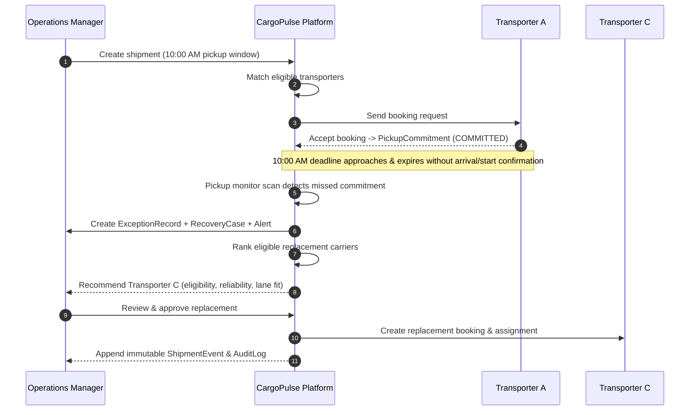
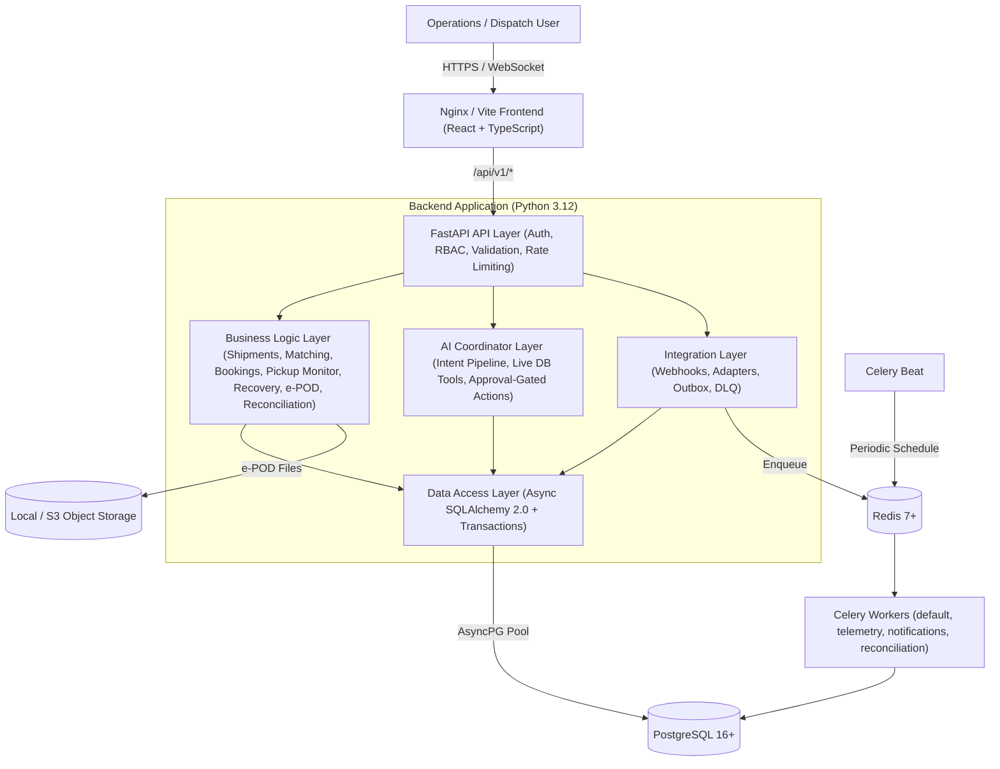

# CargoPulse

> **"Every Shipment. Every Commitment. Every Update. Accountable."**

**Accountable B2B Logistics Management Platform** — independently conceptualized and developed by **Kuruva Surendra Kumar**, inspired by real-world problem discovery and problem statements explored through Razorpay's *Fix My Itch* initiative.

> *Disclaimer: CargoPulse is an independent portfolio project created by Kuruva Surendra Kumar. It is not an official Razorpay project, sponsored project, partnership, or Razorpay-endorsed solution.*

[](docs/testing-guide.md)
[](docs/testing-guide.md)
[](backend/requirements.txt)
[](backend/requirements.txt)
[](frontend/package.json)
[](docs/database-architecture.md)

---

## Table of Contents

1. [Introduction](#1-introduction)
2. [The Real-World Problem](#2-the-real-world-problem)
3. [The CargoPulse Solution](#3-the-cargopulse-solution)
4. [Flagship Business Workflow: From Missed Pickup to Successful Recovery](#4-flagship-business-workflow-from-missed-pickup-to-successful-recovery)
5. [Key Features](#5-key-features)
6. [Technology Stack](#6-technology-stack)
7. [System Architecture](#7-system-architecture)
8. [Reliability Engineering](#8-reliability-engineering)
9. [Skills Demonstrated](#9-skills-demonstrated)
10. [Project Structure](#10-project-structure)
11. [Database Design](#11-database-design)
12. [Installation and Local Setup](#12-installation-and-local-setup)
13. [Environment Variables](#13-environment-variables)
14. [API Documentation](#14-api-documentation)
15. [Testing and Quality Assurance](#15-testing-and-quality-assurance)
16. [Screenshots and UI Preview](#16-screenshots-and-ui-preview)
17. [Business Impact](#17-business-impact)
18. [Future Roadmap](#18-future-roadmap)
19. [Developer and Project Ownership](#19-developer-and-project-ownership)

---

## 1. Introduction

CargoPulse is a multi-tenant B2B logistics accountability platform designed to help manufacturers and industrial shippers manage outbound shipments, coordinate transporters, monitor pickup commitments, track deliveries, handle operational exceptions, and maintain end-to-end shipment accountability.

Most logistics tools stop at basic order CRUD or passive tracking tables. CargoPulse focuses on **operational accountability and recovery**: making every shipment commitment **measurable, traceable, recoverable, and auditable** from dispatch booking through digital Proof of Delivery (e-POD) and freight reconciliation.

---

## 2. The Real-World Problem

Manufacturing and B2B supply chains routinely lose time and margin between dispatch planning and physical truck arrival:

1. **Transporter pickup failures**: Transporters accept shipment bookings but sometimes fail to arrive within the committed pickup window.
2. **Fragmented communication**: Manufacturers, dispatchers, transporters, and drivers coordinate over phone calls, WhatsApp threads, and disconnected spreadsheets.
3. **Lack of accountability**: Operations teams struggle to prove who accepted a commitment, who missed a deadline, and when the failure occurred.
4. **Delayed issue detection**: Missed pickups and transit delays are often discovered hours after dock slots or customer delivery windows have already slipped.
5. **Manual recovery**: When a transporter fails, dispatchers manually call backup carriers, compare rates ad hoc, and re-key bookings under pressure.
6. **Incomplete shipment evidence**: Pickup confirmations, delivery signatures, e-POD photographs, and damage/shortage discrepancies are inconsistently stored.
7. **Poor operational visibility**: Operations leaders lack a unified, data-backed view of transporter reliability, pickup SLA compliance, active exceptions, and recovery outcomes.

### Business Impact
- Production staging bottlenecks and dock congestion.
- Missed customer delivery SLAs and penalty chargebacks.
- Higher spot-freight recovery costs.
- Weak transporter accountability during contract reviews.
- Heavy manual coordination overhead for dispatch teams.
- Limited auditability across operational and financial disputes.

---

## 3. The CargoPulse Solution

CargoPulse models logistics execution as an **accountable state machine** rather than a passive CRUD dashboard:

- **Centralized shipment management**: Structured creation, editing, cancellation, and lifecycle tracking (`DRAFT` through `DELIVERED` / `CLOSED`).
- **Transporter, vehicle, and driver management**: Carrier onboarding, verification/suspension controls, service-area coverage, and fleet assignment.
- **Intelligent transporter matching**: Evaluates eligible carriers using service areas, reliability metrics, and lane suitability.
- **Booking and dispatch management**: Formal booking requests, carrier acceptance/rejection, and driver/vehicle assignment.
- **Pickup commitment monitoring**: Explicit `PickupCommitment` records with scheduled deadlines and arrival/start/completion transitions.
- **Automated missed-pickup detection**: Commitment scanning (`POST /api/v1/pickup-monitoring/scan`) detects overdue unconfirmed commitments and flags `MISSED` breaches.
- **Exception management**: Structured exception lifecycle (`acknowledge`, `assign`, `escalate`, `resolve`, `close`) with severity and SLA tracking.
- **Replacement transporter recommendations & human-approved recovery**: `RecoveryCase` workflows surface ranked replacement carriers and require explicit operations manager approval before creating a replacement booking.
- **Shipment tracking and milestone history**: Append-only `shipment_events` timeline, ETA updates, QR/scan checkpoints, and telemetry webhook ingestion.
- **Digital Proof of Delivery (e-POD)**: Multipart file upload, mandatory evidence checks, verification review, and discrepancy recording.
- **Reconciliation and discrepancy management**: Line-item freight evaluation, dispute handling, and financial closure.
- **Integration monitoring and failure recovery**: Transactional outbox, webhook ingestion, exponential backoff retries, hung-event recovery, and Dead-Letter Queue (DLQ) replay.
- **AI-assisted logistics coordination**: Deterministic tool-backed investigation and approval-gated action proposals.
- **Analytics and audit trails**: Carrier scorecards, route reliability metrics, CSV/JSON exports, and immutable `audit_logs`.

---

## 4. Flagship Business Workflow: From Missed Pickup to Successful Recovery

**Scenario**: A manufacturer creates a shipment requiring pickup at **10:00 AM**.



1. **Shipment is created** with origin, destination, cargo details, and the 10:00 AM pickup deadline.
2. **CargoPulse identifies eligible transporters** via the matching engine.
3. **Transporter A receives a booking request**.
4. **Transporter A accepts the booking**, establishing formal accountability.
5. **A `PickupCommitment` is recorded** with the committed pickup timestamp.
6. **The pickup deadline approaches** and enters the monitoring window.
7. **CargoPulse monitors the commitment** through commitment status transitions and scheduled/on-demand scans.
8. **Transporter A fails to arrive** and no arrival or pickup-start confirmation is recorded. *(Note: Detection is based on configured commitment deadlines and recorded arrival/start confirmations or telemetry events, not passive hardware GPS geofencing.)*
9. **CargoPulse detects the missed commitment** based on configured deadline rules and available evidence.
10. **An `ExceptionRecord` and `RecoveryCase` are created**, and operations staff are notified.
11. **The recovery workflow identifies eligible alternative transporters** from the verified carrier pool.
12. **The system recommends Transporter C** based on eligibility, historical reliability, route/service-area suitability, capacity, and cost data when available.
13. **The operations manager reviews and approves the replacement** via the Recovery Center (`POST /api/v1/pickup-monitoring/recovery-cases/{case_id}/approve`).
14. **A replacement booking is created** and assigned to Transporter C.
15. **The updated shipment status and assignment** are reflected on the shipment timeline and customer-ready tracking view.
16. **The entire failure and recovery sequence** remains preserved in `shipment_events` and immutable `audit_logs`.

**Key Outcome**: CargoPulse converts a missed pickup from an untracked phone-and-WhatsApp fire drill into a **measurable, actionable, and auditable recovery workflow**.

---

## 5. Key Features

| Module | Business Purpose |
| :--- | :--- |
| **Authentication & RBAC** | Dual-token JWT + HttpOnly refresh cookie + double-submit CSRF protection with fine-grained role permissions. |
| **Organization & User Management** | Multi-tenant organization profiles, member invitations/status controls, and custom role-permission mapping. |
| **Operations Dashboard** | Real-time KPIs, volume trends, transporter SLA reliability gauges, failed-pickup queues, and attention tables. |
| **Shipment Management** | Full shipment lifecycle, manifest metadata, validation rules, filtering, and cancellation controls. |
| **Transporter Management** | Carrier directory, verification/suspension workflows, compliance documents, and lane service areas. |
| **Vehicle & Driver Management** | Fleet registration, vehicle capacity tracking, and driver-to-vehicle assignment. |
| **Transporter Matching** | Deterministic carrier scoring and ranked recommendations for open shipments. |
| **Booking & Dispatch** | Booking requests, transporter confirmations, rejections, and shipment assignments. |
| **Pickup Accountability** | `PickupCommitment` tracking (`COMMITTED`, `STARTED`, `MISSED`, `COMPLETED`), deadline scans, and recovery cases. |
| **Exception Management** | Structured triage (`acknowledge`, `assign`, `escalate`, `resolve`, `close`) with exception metrics. |
| **Shipment Tracking** | Chronological event timeline, milestone recording, ETA updates, QR/scan checkpoints, and tracking webhooks. |
| **Proof of Delivery (e-POD)** | Signed/photo e-POD upload, file validation, submission, approval/rejection review, and discrepancy logging. |
| **AI Logistics Coordinator** | Grounded natural-language investigation backed by live DB tools and approval-gated action proposals. |
| **Reconciliation** | Line-item freight invoice evaluation, discrepancy resolution, and financial closeout with CSV export. |
| **Analytics** | Carrier performance scorecards, route reliability breakdowns, and operational exports. |
| **Integration Reliability** | External connection registry, secret rotation, adapter normalization (`erp`, `samsara`, `intangles`, `generic`). |
| **Webhook Event Monitoring** | Inbound webhook ingestion, HMAC signature validation, deduplication, and processing logs. |
| **Retry & DLQ Monitoring** | Outbox/webhook retry visibility, hung-event recovery, and single/batch Dead-Letter Queue replay. |
| **Audit Trail** | Append-only, immutable audit log (`PUT`/`PATCH`/`DELETE` explicitly blocked) with export support. |

---

## 6. Technology Stack

### Implemented in Repository

| Layer | Technologies Verified in Repo |
| :--- | :--- |
| **Frontend** | React 18 (`^18.3.1`), TypeScript (`^5.4.5`), Vite (`^5.2.13`), Tailwind CSS (`^3.4.4`), Lucide React, React Router v6, TanStack Query v5, React Hook Form, Zod, Axios, shadcn/ui-style primitives (`class-variance-authority` / `tailwind-merge` / `clsx`) |
| **Backend** | Python 3.12, FastAPI (`>=0.111.0`), Uvicorn, Pydantic v2 (`>=2.7.0`), SQLAlchemy 2.0 Async (`>=2.0.30`), Alembic (`>=1.13.1`), Argon2 (`argon2-cffi`), PyJWT |
| **Database** | PostgreSQL 16+ (`asyncpg` + `psycopg2-binary` with SQLAlchemy connection pooling) |
| **Background Processing** | Redis 7+, Celery (`>=5.4.0`) with dedicated queues (`default`, `telemetry`, `notifications`, `reconciliation`, `dead_letter`) & Celery Beat |
| **Additional Infrastructure** | FastAPI WebSockets (`app/core/websocket_manager.py`), Local/S3-compatible Object Storage (`app/services/storage_service.py`), Docker & Docker Compose, Nginx (`frontend/nginx.conf`), GitHub Actions CI/CD |
| **Testing** | `pytest`, `pytest-asyncio`, `httpx` (Backend); `Vitest`, `@testing-library/react`, `jsdom` (Frontend) |

### Planned / Not Yet Installed
- **Playwright**: Planned for full-browser E2E test automation (not currently listed in `frontend/package.json` or `backend/requirements.txt`).
- **Live External LLM & Production Telemetry Connectors**: `coordinator_service.py` currently uses deterministic intent routing and DB tools; external carrier adapters (`samsara.py`, `intangles.py`, `erp.py`) are structural normalizers ready for live API credentials.

---

## 7. System Architecture



### Layer Responsibilities
- **Frontend (`frontend/src/`)**: Role-aware SPA routes, TanStack Query data caching, in-memory JWT + CSRF Axios interceptors, React Hook Form + Zod validation, and operational consoles.
- **API Layer (`backend/app/api/v1/endpoints/`)**: FastAPI routers, dependency-injected tenant/permission enforcement (`deps.py`), Pydantic v2 request/response contracts, sliding-window auth rate limiting, and unified JSON error envelopes.
- **Business Logic Layer (`backend/app/services/`)**: Domain state machines for shipments, transporter matching, bookings, pickup commitment monitoring, exception triage, recovery approval, e-POD verification, and freight reconciliation.
- **Data Layer (`backend/app/models/`, `backend/app/core/database.py`)**: 28 relational PostgreSQL tables with UUIDv4 primary keys, UTC timestamps, soft-delete vs. append-only constraints, and connection pooling (`DB_POOL_SIZE=20`, `DB_MAX_OVERFLOW=10`).
- **Background Processing (`backend/app/core/celery_app.py`, `redis.py`)**: Redis-backed Celery workers and Beat scheduler for async task execution and dead-letter routing.
- **Integration Layer (`backend/app/services/integrations/`)**: Webhook ingestion, adapter normalization, outbox publishing, retry scheduling, and DLQ replay.
- **AI Layer (`backend/app/services/ai/`)**: Grounded query synthesis using live database read tools (`tools.py`) plus `AIActionRecord` proposals requiring explicit human approval.

---

## 8. Reliability Engineering

| Mechanism | Status | Implementation Details |
| :--- | :--- | :--- |
| **Idempotency & Duplicate Webhook Detection** | Implemented | Webhook ingestion and tracking endpoints deduplicate repeated provider deliveries before mutating state. |
| **Transactional Outbox Pattern** | Implemented | Domain writes and `OutboxEvent` rows commit atomically; `outbox_service.py` polls using PostgreSQL `FOR UPDATE SKIP LOCKED`. |
| **Exponential Backoff** | Implemented | `event_processor.py` schedules retries with bounded exponential backoff (`min(3600, 2 ** retry_count)` seconds). |
| **Dead-Letter Queues (DLQ) & Replay** | Implemented | Exhausted outbox and webhook events route to DLQ (`is_dead_letter=True`) and support single or batch replay via `dlq_service.py`. |
| **Hung-Event Recovery** | Implemented | `POST /api/v1/integrations/recover-hung` reclaims stalled in-progress integration records. |
| **Immutable Audit History** | Implemented | `audit_logs` and `shipment_events` are append-only; `PUT`, `PATCH`, and `DELETE` on `/api/v1/audit/logs/{log_id}` are blocked. |
| **Human Approval for AI Actions** | Implemented | AI proposals persist as `AIActionRecord` and execute only on explicit `POST /actions/{action_id}/approve`. |
| **Tenant Isolation & Transaction Safety** | Implemented | All tenant queries filter by `organization_id` inside async SQLAlchemy transactions. |
| **Retry Jitter & Circuit Breakers** | Planned | Planned enhancements for outbound HTTP carrier connectors under sustained downstream outages. |

---

## 9. Skills Demonstrated

- **Backend Engineering**: Python 3.12, FastAPI, REST APIs, WebSockets, Pydantic v2, Async SQLAlchemy 2.0, JWT + Argon2 auth, RBAC, sliding-window rate limiting, structured JSON logging.
- **Database Engineering**: PostgreSQL relational modeling (28 tables), Alembic migrations, `FOR UPDATE SKIP LOCKED` concurrency, connection pooling, compound unique constraints, append-only audit design.
- **Frontend Engineering**: React 18, TypeScript, Vite, Tailwind CSS, TanStack Query v5, React Hook Form, Zod, Axios interceptors, responsive multi-screen operations UI.
- **Distributed Systems**: Redis, Celery workers & Beat, transactional outbox, webhook ingestion, idempotency, exponential backoff retries, Dead-Letter Queue replay, hung-event recovery.
- **AI Engineering**: Tool-grounded operational Q&A, deterministic intent routing over live DB state, human-in-the-loop approval safety gates (`AIActionRecord`).
- **Reliability Engineering**: Exception state machines, missed-pickup recovery workflows, freight reconciliation, discrepancy tracking, fault tolerance, immutable audit logs.
- **DevOps & Quality**: Docker & Docker Compose (dev + prod Nginx/non-root containers), Git, GitHub Actions CI/CD, `pytest`, `Vitest`, PostgreSQL backup/restore automation.
- **Forward Deployed Engineering (FDE)**: Customer workflow discovery, translating ambiguous dispatch accountability gaps into explicit state machines, carrier integration design, and traceable operational outcomes.

---

## 10. Project Structure

```text
cargopulse/
├── backend/
│   ├── alembic/                       # Database migration environment & versioned revisions
│   ├── app/
│   │   ├── api/v1/endpoints/          # 19 FastAPI router modules (auth, shipments, bookings, etc.)
│   │   ├── core/                      # Config, database pool, Redis, Celery, security, logging, rate limit
│   │   ├── models/                    # SQLAlchemy 2.0 domain models & enums
│   │   ├── schemas/                   # Pydantic v2 request/response schemas
│   │   ├── scripts/                   # seed_dashboard_data.py (Indian B2B demo dataset)
│   │   ├── services/                  # Business logic, AI coordinator, integration & DLQ services
│   │   └── main.py                    # FastAPI app factory, CORS, security headers, exception handlers
│   ├── tests/                         # 20 pytest suites (auth, RBAC, lifecycle, reliability, security)
│   ├── Dockerfile                     # Development backend container
│   ├── Dockerfile.prod                # Production non-root container + auto-migration entrypoint
│   └── requirements.txt               # Python dependencies
├── frontend/
│   ├── public/images/truck-hero.png   # Auth split-screen hero artwork
│   ├── src/
│   │   ├── api/                       # Typed Axios API clients
│   │   ├── components/                # Layout, auth, dashboard widgets, UI primitives
│   │   ├── context/                   # AuthContext (in-memory token) & ToastContext
│   │   ├── lib/                       # api-client.ts, query-client.ts, utils.ts
│   │   ├── pages/                     # Route views (dashboard, shipments, pickup, recovery, AI, etc.)
│   │   └── test/                      # Vitest unit/component tests
│   ├── Dockerfile                     # Development frontend container (Node 22)
│   ├── Dockerfile.prod                # Production multi-stage Nginx build
│   ├── nginx.conf                     # SPA fallback, gzip, security headers, /api/ proxy
│   └── package.json                   # Node dependencies & scripts
├── docs/                              # Architecture, DB ERD, API, Auth, Deployment, Runbook, QA, Workflows
├── scripts/
│   ├── backup-db.sh                   # Automated compressed pg_dump + retention + S3 hook
│   └── restore-db.sh                  # Verified pg_restore + Alembic validation
├── docker-compose.yml                 # Local development stack
├── docker-compose.prod.yml            # Production deployment stack
├── .env.example                       # Local development env template
└── .env.production.example            # Production env template (no secrets)
```

---

## 11. Database Design

CargoPulse uses **PostgreSQL** as its sole primary operational and analytical store across **28 domain models** (see [docs/database-architecture.md](docs/database-architecture.md) for the full ERD):

- **Identity, Tenancy & Access Control (`auth.py`)**: `organizations`, `users`, `roles`, `permissions`, `user_roles`, `role_permissions`, `refresh_sessions`, `password_reset_tokens`.
- **Fleet & Carriers (`transporter.py`)**: `transporters`, `vehicles`, `drivers`, `transporter_service_areas`, `organization_transporters`.
- **Core Dispatch & Accountability (`shipment.py`)**: `shipments`, `transporter_bookings`, `shipment_assignments`, `pickup_commitments`, `shipment_events` (append-only).
- **Exceptions, Recovery, e-POD & Reconciliation (`operations.py`)**: `exceptions`, `recovery_cases`, `proof_of_delivery`, `delivery_discrepancies`, `reconciliation_records`, `logistics_reconciliation_items`.
- **Integrations, AI & Audit (`integrations.py`, `ai.py`)**: `integration_connections`, `webhook_events`, `outbox_events`, `notifications`, `audit_logs` (immutable), `ai_conversations`, `ai_messages`, `ai_action_records`.

**Data Integrity Guarantees**:
- **Tenant Isolation**: Tenant-owned tables include indexed `organization_id` foreign keys and compound uniqueness constraints.
- **Soft-Delete vs. Immutability**: Operational entities support `SoftDeleteMixin` (`is_deleted`, `deleted_at`), while `shipment_events`, `audit_logs`, `outbox_events`, and `webhook_events` preserve historical immutability.

---

## 12. Installation and Local Setup

### Prerequisites
- **Python 3.12+**
- **Node.js 22+** and **npm 10+**
- **PostgreSQL 16+** and **Redis 7+** (or **Docker & Docker Compose v2**)

### Option A: Docker Compose (Recommended when Docker Engine is running)

```bash
git clone https://github.com/Surendra571/Cargopulse.git
cd cargopulse
cp .env.example .env

# Start PostgreSQL, Redis, FastAPI, Celery Worker, and Vite Frontend
docker compose up -d

# Run database migrations and seed Indian B2B demo data
docker exec cargopulse_backend alembic upgrade head
docker exec cargopulse_backend python -m app.scripts.seed_dashboard_data
```

### Option B: Local Development (Without Docker)

#### 1. Configure Environment & Database
```bash
cp .env.example .env
# Ensure PostgreSQL is running and matches DATABASE_URL / DATABASE_SYNC_URL in .env
```

#### 2. Backend Setup & Migrations
```bash
cd backend
python -m venv .venv
# Linux/macOS: source .venv/bin/activate
# Windows PowerShell: .\.venv\Scripts\Activate.ps1
pip install -r requirements.txt

alembic upgrade head
python -m app.scripts.seed_dashboard_data
uvicorn app.main:app --host 0.0.0.0 --port 8000 --reload
```

#### 3. Celery Worker (Optional for local eager mode, required for async queues)
```bash
cd backend
celery -A app.core.celery_app.celery_app worker --loglevel=info -Q default,telemetry,notifications,reconciliation
```

#### 4. Frontend Setup
```bash
cd frontend
npm install --legacy-peer-deps
npm run dev
```

#### 5. Local URLs
- **Frontend UI**: `http://localhost:5173`
- **Backend API & Swagger Docs**: `http://localhost:8000/api/v1/docs`
- **Health Check**: `http://localhost:8000/api/v1/healthz`

---

## 13. Environment Variables

Copy `.env.example` to `.env` for local development (or `.env.production.example` to `.env.production` for production deployments). **Never commit `.env` or real credentials.**

| Variable | Purpose | Local Default (`.env.example`) |
| :--- | :--- | :--- |
| `ENVIRONMENT` | Runtime mode (`development` / `production`) | `development` |
| `DEBUG` | Enables debug mode and Swagger `/docs` | `true` |
| `SECRET_KEY` | JWT signing key (must be >=32 chars; prod rejects dev prefix) | Placeholder dev string |
| `ALLOWED_ORIGINS` | Comma-separated CORS origins | `http://localhost:5173,http://localhost:3000,http://127.0.0.1:5173` |
| `DATABASE_URL` | Async SQLAlchemy PostgreSQL URI (`asyncpg`) | `postgresql+asyncpg://...` |
| `DATABASE_SYNC_URL` | Sync SQLAlchemy URI for Alembic (`psycopg2`) | `postgresql+psycopg2://...` |
| `DB_POOL_SIZE` / `DB_MAX_OVERFLOW` | Connection pool tuning | `20` / `10` |
| `REDIS_URL` | Redis cache & pub/sub URI | `redis://localhost:6379/0` |
| `CELERY_BROKER_URL` / `CELERY_RESULT_BACKEND` | Celery Redis broker & result store | `redis://localhost:6379/1` / `/2` |
| `CELERY_TASK_ALWAYS_EAGER` | Run tasks synchronously in local dev without worker | `false` |
| `LOG_LEVEL` / `LOG_FORMAT` | Structured JSON logging configuration | `INFO` / `json` |
| `VITE_API_BASE_URL` | Frontend Axios base URL | `http://localhost:8000` |

Additional production variables (`COOKIE_SECURE`, `STORAGE_BACKEND`, `S3_*`, `SENTRY_DSN`, `RATE_LIMIT_ENABLED`) are documented in [.env.production.example](.env.production.example) and [docs/deployment.md](docs/deployment.md).

---

## 14. API Documentation

Interactive OpenAPI/Swagger documentation is available in development at `http://localhost:8000/api/v1/docs` (automatically disabled in production when `DEBUG=false`). All endpoints are prefixed with `/api/v1`:

| Group | Prefix | Key Implemented Endpoints |
| :--- | :--- | :--- |
| **Health** | `/api/v1/healthz` | `GET ""`, `GET /live`, `GET /ready` |
| **Authentication** | `/api/v1/auth` | `POST /register`, `POST /login`, `POST /refresh`, `POST /logout`, `GET /me`, `POST /forgot-password`, `POST /reset-password`, `POST /change-password` |
| **Organizations & Users** | `/api/v1/organizations` | Organization profile, members, roles, and permission assignments |
| **Operations Dashboard** | `/api/v1/dashboard` | `GET /overview`, `GET /metrics`, `GET /charts/volume`, `GET /charts/transporters`, `GET /tables/*` |
| **Shipments** | `/api/v1/shipments` | `POST ""`, `GET ""`, `GET /{id}`, `PUT /{id}`, `POST /{id}/cancel` |
| **Matching** | `/api/v1/matching` | `GET /shipments/{id}/recommendations`, `POST /shipments/{id}/auto-match` |
| **Transporters, Vehicles, Drivers** | `/api/v1/transporters`, `/vehicles`, `/drivers` | CRUD, `/verify`, `/suspend`, `/documents`, `/service-areas`, `/assign-vehicle` |
| **Bookings** | `/api/v1/bookings` | Create, list, get, confirm, reject, cancel, and assign bookings |
| **Pickup Monitoring** | `/api/v1/pickup-monitoring` | `GET /commitments`, `POST /commitments/{id}/{arrival,start,complete,fail}`, `POST /scan`, `GET /recovery-cases`, `POST /recovery-cases/{id}/approve` |
| **Exceptions** | `/api/v1/exceptions` | `GET ""`, `GET /metrics`, `POST ""`, `POST /{id}/{acknowledge,assign,escalate,resolve,close}` |
| **Tracking** | `/api/v1/tracking` | `GET /shipments`, `GET /shipments/{id}/timeline`, `POST /shipments/{id}/events`, `POST /shipments/{id}/eta`, `POST /scan`, `POST /webhook` |
| **Proof of Delivery** | `/api/v1/pod` | `POST /upload`, `GET /files/download`, `POST /shipments/{id}/submit`, `POST /shipments/{id}/review`, `GET /shipments/{id}`, `GET ""` |
| **AI Coordinator** | `/api/v1/ai-coordinator` | `POST /conversations`, `GET /conversations`, `POST /conversations/{id}/messages`, `POST /actions/{id}/approve`, `POST /actions/{id}/reject` |
| **Reconciliation** | `/api/v1/reconciliation` | `GET ""`, `GET /export`, `GET /{shipment_id}`, `POST /{shipment_id}/evaluate`, `PATCH /items/{item_id}`, `POST /{shipment_id}/close` |
| **Analytics & Audit** | `/api/v1/analytics`, `/api/v1/audit` | `GET /overview`, `GET /transporters`, `GET /routes`, `GET /dashboard`, `GET /export`, `GET /logs`, `POST /events` |
| **Integrations** | `/api/v1/integrations` | `POST /webhooks/ingest/{source}`, `GET /connections`, `GET /webhooks`, `GET /outbox`, `GET /monitoring/dashboard`, `GET /dlq`, `POST /dlq/.../replay`, `POST /recover-hung` |

---

## 15. Testing and Quality Assurance

### Verified Test Execution Results

| Suite | Command | Environment & Scope | Observed Result |
| :--- | :--- | :--- | :--- |
| **Backend (`pytest`)** | `pytest -q --tb=short` (from `backend/`) | Real PostgreSQL 17 instance (`127.0.0.1:5433`) via `httpx.AsyncClient` + `ASGITransport` across 20 test modules (auth, RBAC, tenant isolation, shipments, matching, bookings, pickup/exceptions, tracking, e-POD, AI coordinator, reconciliation, analytics/audit, integration reliability, E2E lifecycle) | **120 passed**, 13 deprecation/runtime warnings |
| **Frontend (`Vitest`)** | `npx vitest run` (from `frontend/`) | `jsdom` environment with mocked `AuthContext` (`src/test/auth.test.tsx`, `src/test/routes.test.tsx`) | **2 test files passed, 4 tests passed** |
| **Frontend Typecheck & Build** | `npm run build` (`tsc -b && vite build`) | TypeScript compilation + Vite production bundle | **Exited 0** (`dist/` built cleanly) |

### Test Coverage Breakdown
- **Unit & API Validation**: Schema validation, state transitions, error envelopes (`test_shipments.py`, `test_health.py`).
- **Database Integration**: Real async PostgreSQL transactions, constraints, and pooling (`test_database.py`, `test_qa_backend_comprehensive.py`).
- **Auth, RBAC & Tenant Isolation**: JWT/refresh rotation, CSRF validation, permission gates, cross-tenant isolation (`test_auth.py`, `test_organization_rbac.py`, `test_qa_security_audit.py`).
- **Workflow & E2E Lifecycle**: Full shipment-to-reconciliation flow, missed-pickup recovery, AI approval gating (`test_qa_e2e_full_lifecycle.py`, `test_ai_coordinator.py`).
- **Webhooks, Outbox & Idempotency**: Duplicate webhook suppression, retry backoff, DLQ replay (`test_integrations_engine.py`, `test_qa_reliability.py`).
- **Planned**: Playwright browser-level E2E automation.

---

## 16. Screenshots and UI Preview

### Available Visual Assets
- **Split-Screen Truck Authentication Hero**: [`frontend/public/images/truck-hero.png`](frontend/public/images/truck-hero.png)

### UI Screen Previews (To Be Captured from Running App)
| Screen | Route | Status |
| :--- | :--- | :--- |
| **Sign In & Sign-In Options** | `/login` | Implemented — *Screenshot placeholder: `docs/screenshots/login.png`* |
| **Operations Dashboard** | `/overview` | Implemented — *Screenshot placeholder: `docs/screenshots/dashboard.png`* |
| **Pickup Monitoring & Recovery Center** | `/pickup-monitoring`, `/recovery` | Implemented — *Screenshot placeholder: `docs/screenshots/recovery-center.png`* |
| **AI Logistics Coordinator** | `/ai-coordinator` | Implemented — *Screenshot placeholder: `docs/screenshots/ai-coordinator.png`* |
| **Integration & DLQ Console** | `/integrations/dlq` | Implemented — *Screenshot placeholder: `docs/screenshots/integrations-dlq.png`* |

---

## 17. Business Impact

CargoPulse is engineered to deliver measurable operational improvements for B2B shippers:
- **Faster missed-pickup discovery**: Replaces ad-hoc phone follow-ups with explicit commitment deadlines and automated breach detection.
- **Structured transporter replacement**: Shortens recovery coordination by ranking eligible backup carriers and routing replacements through one-click manager approval.
- **Clearer pickup accountability**: Records booking acceptance, commitment timestamps, arrival/start confirmations, and breach history per transporter.
- **Reduced manual coordination**: Centralizes dispatch, exceptions, e-POD evidence, and reconciliation in one tenant-isolated workspace.
- **Traceable audit & dispute resolution**: Preserves immutable timelines and evidence for carrier reviews and freight invoice settlement.

---

## 18. Future Roadmap

All items below are **planned enhancements** (not yet implemented):
- **Live GPS Telematics Integrations**: Real-time ELD/GPS provider polling and geofence-triggered arrival detection.
- **Expanded Transporter Connectors**: Production ERP/TMS adapters beyond the current payload normalizers.
- **Predictive Delay Detection**: Historical lane-variance modeling to flag at-risk pickups before deadlines expire.
- **LLM-Backed AI Coordinator**: Connecting an external LLM provider on top of the existing deterministic tool & approval-gate framework.
- **Customer-Facing Shipment Portal**: Read-only external tracking and e-POD links for consignees.
- **Production Observability & Alerting**: Full OpenTelemetry tracing, Prometheus/Grafana dashboards, and PagerDuty/Slack alert routing.
- **Playwright E2E Suite**: Automated headless browser tests in CI.

---

## 19. Developer and Project Ownership

- **Project Built By**: **Kuruva Surendra Kumar**
- **Project Inspiration**: Independently conceptualized and developed after exploring real-world B2B operational problem statements through Razorpay's *Fix My Itch* initiative.
- **Development Approach**: Independent product discovery, workflow modeling, full-stack architecture, database & reliability engineering, automated testing, and iterative refinement.

> *CargoPulse is an independent personal/portfolio project and is not affiliated with, sponsored by, or endorsed by Razorpay.*
