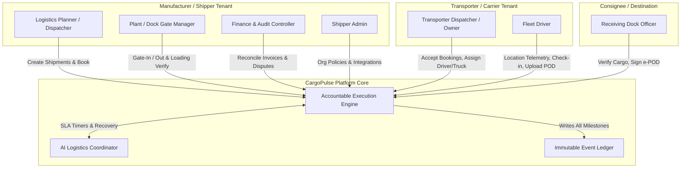

# 01. Product Requirements Document (PRD)

## 1. Executive Summary
**CargoPulse** is an accountable, multi-tenant B2B logistics coordination and execution platform engineered specifically for manufacturers, industrial distributors, and enterprise shippers. While traditional Transport Management Systems (TMS) focus primarily on freight rate shopping or static booking dispatch, CargoPulse bridges the critical operational gap between **pickup commitment, ground execution accountability, and proof of delivery**.

Industrial manufacturers lose millions annually due to:
- "Ghost" transporter commitments where a transporter accepts a load but fails to position a truck at the loading dock.
- Zero visibility into loading dock congestion and turnaround times.
- Late-detected pickup failures causing missed delivery SLAs, line stoppages, and customer penalties.
- Fractured communication via informal phone calls, emails, and WhatsApp groups with zero audit trail.
- Delayed freight invoice reconciliation driven by disputed detention, demurrage, and damages.

CargoPulse treats **Pickup Accountability** as a first-class operational pillar: establishing strict digital handshakes, automated SLA monitoring, proactive failure detection, fast-path recovery dispatch, end-to-end milestone tracking, tamper-evident proof of delivery (POD), and automated invoice discrepancy reconciliation.

---

## 2. Platform Vision & Objectives

### 2.1 Strategic Goals
1. **Zero Unaccounted Missed Pickups**: Reduce unnotified pickup failures to 0% by enforcing automated confirmation checkpoints (T-4h, T-2h, T-1h) and proactive recovery triggers.
2. **Deterministic Accountability**: Create an immutable operational audit log for every shipment, gate arrival, loading event, route delay, and delivery signature.
3. **Automated Recovery**: When a carrier fails to place a vehicle within the SLA threshold, the system automatically triggers an automated recovery cascade (waterfall / spot tender / internal standby fleet).
4. **OTIF Improvement**: Improve On-Time In-Full (OTIF) shipping performance by at least 25% across enterprise manufacturing sites.
5. **Streamlined Reconciliation**: Eliminate paper disputes by matching ERP shipping orders, digital gate logs, GPS tracking records, and signed e-PODs against contracted rate cards.

---

## 3. Target User Personas & Ecosystem

CargoPulse operates across a multi-tenant B2B ecosystem representing Shippers (Manufacturers), Transporters (Carriers/3PLs), Consignees (Receivers), and System Operators.

### 3.1 Persona Profiles

| Persona | Role | Key Responsibilities & Pain Points | Primary System Modules |
|---|---|---|---|
| **Logistics Planner (Shipper)** | Mid-level ops coordinator | Plans daily outbound dispatch, selects carriers, monitors dock commitments, handles escalations when trucks don't arrive. | Shipment Management, Booking & Dispatch, Matching, Operations Dashboard |
| **Plant / Dock Supervisor (Shipper)** | On-site warehouse manager | Controls dock queue, validates vehicle and driver physical credentials at the factory gate, records tare/gross weights, tracks loading dwell time. | Pickup Accountability, Vehicle & Driver Verification, Dock Ops |
| **Finance / Freight Auditor (Shipper)** | Accounts payable & freight audit | Reconciles carrier freight invoices with contractual rates, verifies detention fees against gate timestamps, approves billing. | Reconciliation, Proof of Delivery, Analytics, Audit Trail |
| **Transporter Dispatcher (Carrier)** | Carrier fleet operations manager | Receives load tenders, commits vehicles/drivers, monitors driver progress toward pickup, manages vehicle breakdowns. | Transporter Portal, Vehicle & Driver Management, Booking Dispatch |
| **Fleet Driver (Transporter)** | Driver operating vehicle | Navigates to shipper plant, completes gate check-in via OTP / QR code, drives transit route, collects consignee e-POD signature. | Driver Mobile Web / Tracking, POD Capture |
| **Receiving Dock Officer (Consignee)** | Goods inward manager | Inspects inbound cargo, records damages or shortages on delivery, signs electronic delivery receipt. | Consignee Portal, Proof of Delivery |
| **Platform Administrator** | System Super-Admin | Onboards shipper and transporter organizations, monitors integration health, enforces global tenant compliance. | Organization Management, RBAC, Integration Monitoring, Webhooks |

---

## 4. Multi-Tenant Architecture Principles

1. **Logical Tenant Isolation**: Every business entity (Manufacturer, 3PL Transporter) is modeled as a Tenant. Shippers own shipments, bookings, and freight contracts. Transporters access only the bookings, vehicles, and shipments explicitly tendered or assigned to them.
2. **Cross-Tenant Collaboration Handshakes**: Transporters do not view other transporters' bidding, rates, or performance metrics. Shared entities (e.g., a Booking linking Shipper Tenant $A$ and Transporter Tenant $B$) enforce dual-tenant access controls.
3. **Immutability of Operational History**: Once a milestone event (e.g., `GATE_IN`, `LOADING_COMPLETED`, `POD_SIGNED`) is logged, it cannot be modified or deleted. Subsequent corrections are logged as compensating correction events.
4. **Pluggable Integration Architecture**: Direct webhook and REST interfaces with enterprise ERPs (SAP S/4HANA, Oracle SCM, Microsoft Dynamics) for automated sales order ingestion and shipment status synchronizations.

---

## 5. Scope Boundaries

### In Scope
- Outbound B2B manufacturing shipments (FTL - Full Truckload, PTL - Partial Truckload).
- Transporter master data, fleet compliance (insurance, fitness, permits), driver KYC (license, biometric/photo ID).
- Dynamic transporter selection rules (contracted allocation, rate card ranking, performance-weighted).
- Strict pickup accountability workflows (automated readiness pings, geo-fenced check-in, OTP verification, detention tracking).
- Automated exception triggers for missed SLAs and AI-assisted recovery recommendations.
- Milestone tracking via GPS telematics (webhooks, cellular, driver app location updates).
- Tamper-evident e-POD capturing geo-coordinates, consignee signature, cargo photographs, and discrepancy annotations.
- Three-way invoice reconciliation (Purchase Order / Contract Rate + Operational Gate Log + e-POD).

### Out of Scope (Phase 1)
- B2C last-mile parcel routing and residential delivery.
- Direct embedded payment gateway processing / banking settlements (CargoPulse generates audited reconciliation statements; payment execution remains in ERP/AP systems).
- Ocean and International Air Cargo customs clearance workflows (focus is domestic primary and secondary road/rail logistics).
