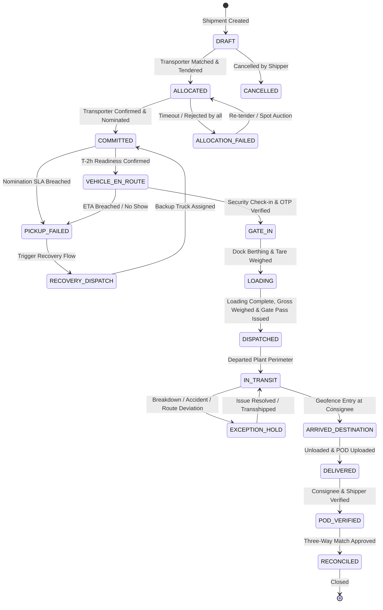
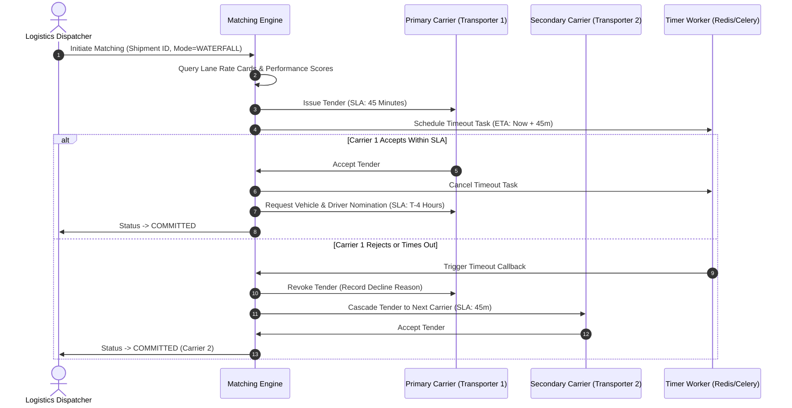
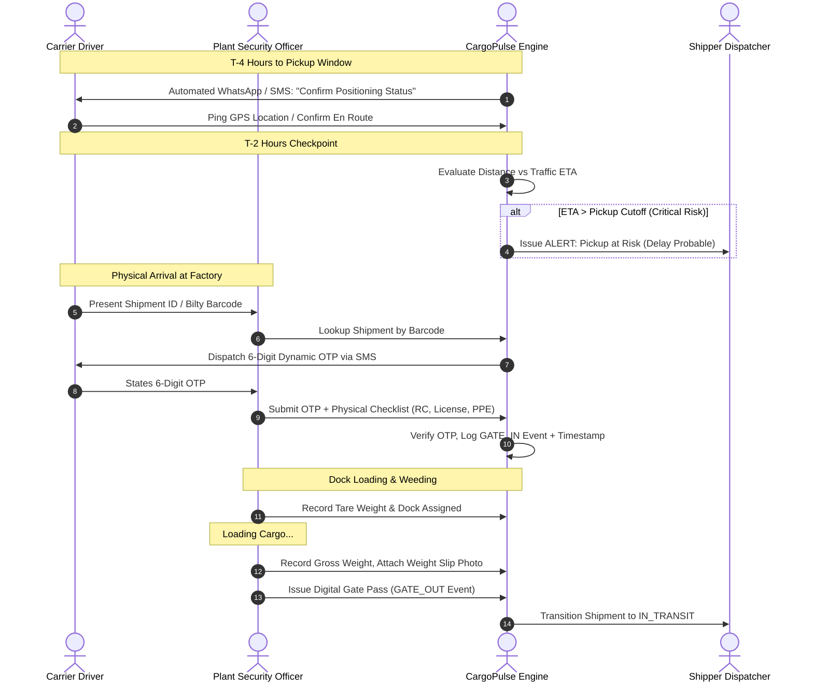
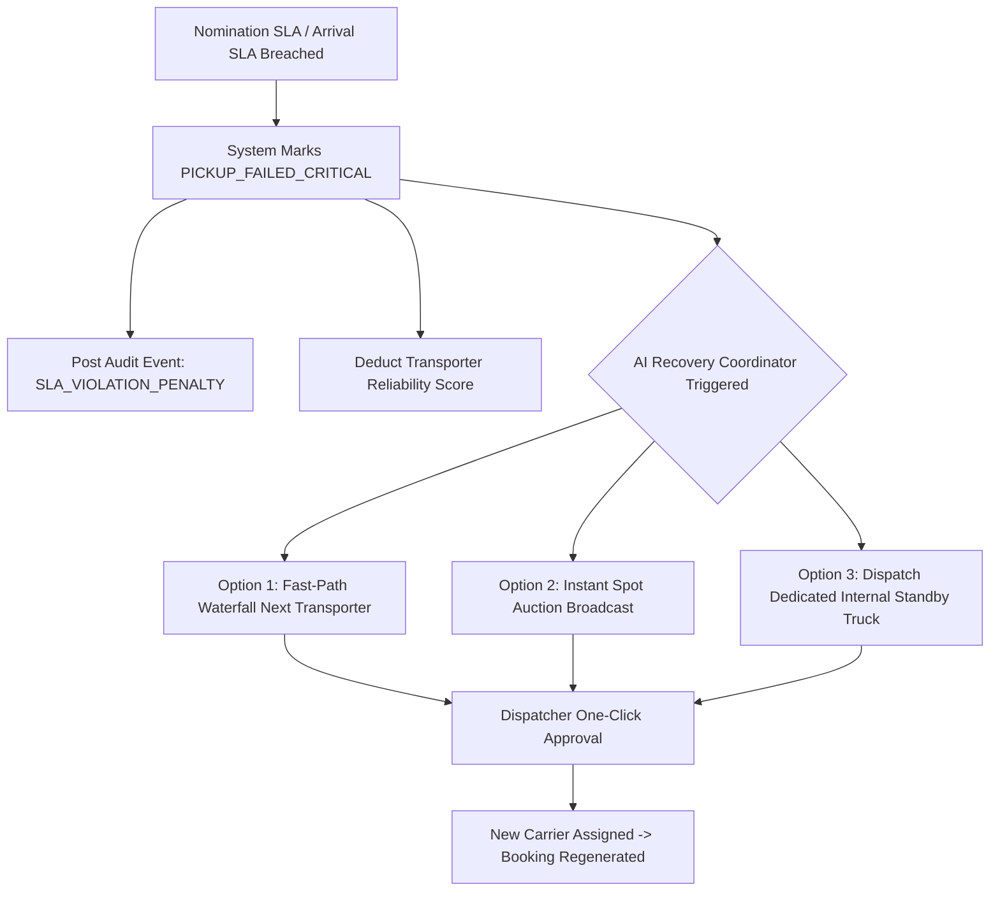
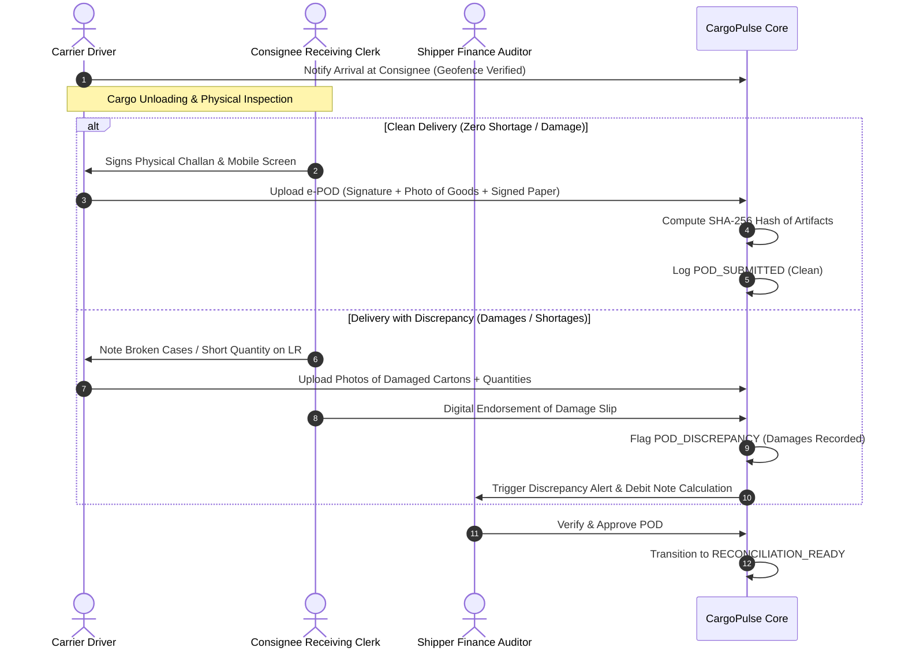

# 05. Business Workflows & State Machines

This document outlines the core operational workflows and formal finite state machines (FSM) governing CargoPulse.

---

## 1. Master Shipment Lifecycle State Machine

The shipment entity progresses through a deterministic, auditable lifecycle. Every state transition is atomic, validated, and logged to the immutable audit ledger.



### 1.1 State Transition Invariant Table

| Origin State | Permitted Destination | Triggering Event / Action | Required Pre-Conditions |
|---|---|---|---|
| `DRAFT` | `ALLOCATED` | Tender dispatched to carrier | Cargo weight, origin, destination, pickup window defined. |
| `DRAFT` | `CANCELLED` | Order cancellation | Shipment not yet tendered or committed. |
| `ALLOCATED` | `COMMITTED` | Transporter accepts tender | Carrier has valid contract or accepted spot rate. |
| `ALLOCATED` | `ALLOCATION_FAILED`| Waterfall expiration | All tendered carriers declined or timed out. |
| `COMMITTED` | `VEHICLE_EN_ROUTE`| Carrier confirms driver movement | Valid vehicle RC, insurance, and driver license verified. |
| `COMMITTED` | `PICKUP_FAILED` | SLA breach timer fires | Transporter failed to confirm driver positioning by SLA cutoff. |
| `VEHICLE_EN_ROUTE` | `GATE_IN` | Gate Officer checks in vehicle | Driver provides correct 6-digit OTP; GPS confirms arrival. |
| `GATE_IN` | `LOADING` | Dock berthing recorded | Vehicle passes physical inspection; tare weight logged. |
| `LOADING` | `DISPATCHED` | Gate pass generated | Gross weight logged; e-Way Bill attached; driver verified. |
| `DISPATCHED` | `IN_TRANSIT` | Vehicle clears plant geofence | Gate-out timestamp confirmed by security scan. |
| `IN_TRANSIT` | `EXCEPTION_HOLD`| Exception reported | GPS stoppage > 60m, breakdown reported, or accident. |
| `IN_TRANSIT` | `ARRIVED_DEST` | Geofence entry at consignee | GPS coordinate enters consignee radius ($\le 300\text{m}$). |
| `ARRIVED_DEST`| `DELIVERED` | Unloading complete | Driver uploads e-POD photos and consignee digital signature. |
| `DELIVERED` | `POD_VERIFIED` | Shipper verifies documents | Inspection of delivery shortages/damages; hash verified. |
| `POD_VERIFIED`| `RECONCILED` | Invoice audit complete | Rate card + gate detention + net invoice matched. |

---

## 2. Transporter Matching & Tendering Workflow



---

## 3. Pickup Accountability & Gate Operations Workflow

This workflow represents CargoPulse's foundational guarantee: eliminating "ghost trucks" and enforcing physical gate dwell tracking.



---

## 4. Failed Pickup Recovery Cascade

When a transporter commits to a load but fails to place a vehicle within the guaranteed SLA window, the automated recovery cascade initiates:



---

## 5. Delivery, e-POD & Discrepancy Recording Workflow



---

## 6. Three-Way Reconciliation Workflow

```mermaid
graph LR
    subgraph Input1["1. Contract Rate Card"]
        R1[Base Freight Rate]
        R2[Free Detention Hours: 4h]
        R3[Detention Rate: $15/hr]
    end

    subgraph Input2["2. Gate Execution Logs"]
        G1[Gate In: 10:00 AM]
        G2[Gate Out: 06:00 PM]
        G3[Total Dwell: 8h]
        G4[Billable Detention: 4h]
    end

    subgraph Input3["3. Carrier Invoice"]
        I1[Claimed Freight: $500]
        I2[Claimed Detention: $60 (4h * $15)]
        I3[Total Claimed: $560]
    end

    subgraph Engine["Reconciliation Engine"]
        M[Automated 3-Way Match]
    end

    Input1 --> Engine
    Input2 --> Engine
    Input3 --> Engine

    Engine --> V{Discrepancy Check}
    V -->|Match <= $1.00| PASS[Auto-Approve Payment Voucher]
    V -->|Mismatch > Threshold| DISPUTE[Route to Freight Auditor with Dispute Diff]
```
