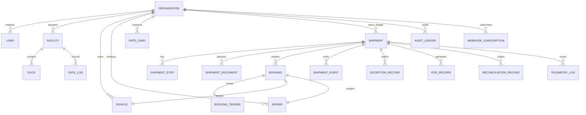

# 06. Database ERD & Schema Design

CargoPulse mandates **PostgreSQL as the ONLY primary database**. Redis is utilized strictly as a cache, rate-limiting store, pub/sub bus, and Celery task broker. No MongoDB or secondary document stores are permitted.

---

## 1. Multi-Tenant Relational Data Architecture

### Core Design Principles
1. **Tenant Isolation**: Every tenant-owned table incorporates a mandatory `tenant_id (UUID)` foreign key referencing `organizations.id`. Compound unique indexes and query predicates guarantee strict data partitioning.
2. **Deterministic Primary Keys**: All tables utilize **UUIDv7** primary keys (`id UUID PRIMARY KEY`), combining chronological sortability (time-ordered) with global uniqueness.
3. **Immutable Operational History**: High-frequency operational milestones, telemetry events, and audit logs are stored in append-only tables (`shipment_events`, `telemetry_logs`, `audit_ledger`).
4. **Referential Integrity & Constraints**: Strict database-level foreign keys, `CHECK` constraints (e.g., non-negative weights, valid enum states), and unique constraints to prevent data corruption.
5. **JSONB with Schema Rigor**: Flexible structures (e.g., custom cargo properties, webhook payloads, rate matrices) use `JSONB` alongside PostgreSQL JSON schema validation constraints where applicable.

---

## 2. Entity Relationship Diagram (ERD)



---

## 3. Database Schema Definitions (DDL Specification)

### 3.1 Organization & Identity

```sql
-- Enums
CREATE TYPE org_type_enum AS ENUM ('SHIPPER', 'TRANSPORTER', 'PLATFORM');
CREATE TYPE user_role_enum AS ENUM (
    'SHIPPER_ADMIN', 'LOGISTICS_MANAGER', 'DISPATCHER', 'GATE_OFFICER', 
    'FINANCE_AUDITOR', 'SHIPPER_VIEWER', 'CARRIER_ADMIN', 'CARRIER_DISPATCHER', 
    'DRIVER', 'CARRIER_BILLING', 'PLATFORM_SUPERADMIN', 'PLATFORM_SUPPORT'
);

-- Organizations
CREATE TABLE organizations (
    id UUID PRIMARY KEY,
    name VARCHAR(255) NOT NULL,
    trade_name VARCHAR(255),
    org_type org_type_enum NOT NULL,
    tax_identifier VARCHAR(64) NOT NULL UNIQUE,
    billing_address JSONB NOT NULL,
    is_active BOOLEAN NOT NULL DEFAULT TRUE,
    created_at TIMESTAMPTZ NOT NULL DEFAULT CURRENT_TIMESTAMP,
    updated_at TIMESTAMPTZ NOT NULL DEFAULT CURRENT_TIMESTAMP
);

CREATE INDEX idx_organizations_org_type ON organizations(org_type);

-- Facilities (Plants, Warehouses, Hubs)
CREATE TABLE facilities (
    id UUID PRIMARY KEY,
    tenant_id UUID NOT NULL REFERENCES organizations(id) ON DELETE CASCADE,
    code VARCHAR(64) NOT NULL,
    name VARCHAR(255) NOT NULL,
    address JSONB NOT NULL,
    geo_point POINT,
    geofence_radius_meters INT NOT NULL DEFAULT 300,
    is_active BOOLEAN NOT NULL DEFAULT TRUE,
    created_at TIMESTAMPTZ NOT NULL DEFAULT CURRENT_TIMESTAMP,
    updated_at TIMESTAMPTZ NOT NULL DEFAULT CURRENT_TIMESTAMP,
    CONSTRAINT uq_facility_tenant_code UNIQUE (tenant_id, code)
);

CREATE INDEX idx_facilities_tenant ON facilities(tenant_id);

-- Docks
CREATE TABLE docks (
    id UUID PRIMARY KEY,
    facility_id UUID NOT NULL REFERENCES facilities(id) ON DELETE CASCADE,
    dock_number VARCHAR(32) NOT NULL,
    dock_type VARCHAR(64) NOT NULL DEFAULT 'STANDARD',
    is_available BOOLEAN NOT NULL DEFAULT TRUE,
    created_at TIMESTAMPTZ NOT NULL DEFAULT CURRENT_TIMESTAMP,
    CONSTRAINT uq_dock_facility_number UNIQUE (facility_id, dock_number)
);

-- Users
CREATE TABLE users (
    id UUID PRIMARY KEY,
    tenant_id UUID NOT NULL REFERENCES organizations(id) ON DELETE RESTRICT,
    email VARCHAR(255) NOT NULL UNIQUE,
    phone_number VARCHAR(32) NOT NULL,
    full_name VARCHAR(255) NOT NULL,
    password_hash VARCHAR(255) NOT NULL,
    role user_role_enum NOT NULL,
    facility_scope_id UUID REFERENCES facilities(id) ON DELETE SET NULL,
    is_active BOOLEAN NOT NULL DEFAULT TRUE,
    is_mfa_enabled BOOLEAN NOT NULL DEFAULT FALSE,
    mfa_secret VARCHAR(64),
    last_login_at TIMESTAMPTZ,
    created_at TIMESTAMPTZ NOT NULL DEFAULT CURRENT_TIMESTAMP,
    updated_at TIMESTAMPTZ NOT NULL DEFAULT CURRENT_TIMESTAMP
);

CREATE INDEX idx_users_tenant_role ON users(tenant_id, role);
```

### 3.2 Transporter Master Data, Fleet & Drivers

```sql
CREATE TYPE vehicle_class_enum AS ENUM (
    'FLATBED_32FT', 'CONTAINER_20FT', 'CONTAINER_32FT_SXL', 
    'CONTAINER_32FT_MXL', 'TRAILER_40FT', 'TANKER', 'REFRIGERATED'
);

CREATE TYPE asset_status_enum AS ENUM ('ACTIVE', 'MAINTENANCE', 'SUSPENDED', 'BLACKLISTED');

-- Vehicles
CREATE TABLE vehicles (
    id UUID PRIMARY KEY,
    transporter_tenant_id UUID NOT NULL REFERENCES organizations(id) ON DELETE RESTRICT,
    registration_number VARCHAR(32) NOT NULL UNIQUE,
    vehicle_class vehicle_class_enum NOT NULL,
    payload_capacity_kg NUMERIC(10, 2) NOT NULL CHECK (payload_capacity_kg > 0),
    volume_capacity_cft NUMERIC(10, 2),
    gps_device_id VARCHAR(128),
    fastag_id VARCHAR(128),
    rc_expiry_date DATE NOT NULL,
    fitness_expiry_date DATE NOT NULL,
    insurance_expiry_date DATE NOT NULL,
    permit_expiry_date DATE NOT NULL,
    status asset_status_enum NOT NULL DEFAULT 'ACTIVE',
    created_at TIMESTAMPTZ NOT NULL DEFAULT CURRENT_TIMESTAMP,
    updated_at TIMESTAMPTZ NOT NULL DEFAULT CURRENT_TIMESTAMP
);

CREATE INDEX idx_vehicles_transporter ON vehicles(transporter_tenant_id);

-- Drivers
CREATE TABLE drivers (
    id UUID PRIMARY KEY,
    transporter_tenant_id UUID NOT NULL REFERENCES organizations(id) ON DELETE RESTRICT,
    full_name VARCHAR(255) NOT NULL,
    mobile_number VARCHAR(32) NOT NULL UNIQUE,
    license_number VARCHAR(64) NOT NULL UNIQUE,
    license_expiry_date DATE NOT NULL,
    kyc_document_url TEXT,
    safety_rating NUMERIC(3, 2) NOT NULL DEFAULT 5.00,
    status asset_status_enum NOT NULL DEFAULT 'ACTIVE',
    created_at TIMESTAMPTZ NOT NULL DEFAULT CURRENT_TIMESTAMP,
    updated_at TIMESTAMPTZ NOT NULL DEFAULT CURRENT_TIMESTAMP
);

CREATE INDEX idx_drivers_transporter ON drivers(transporter_tenant_id);
```

### 3.3 Rate Cards & Transporter Allocation

```sql
CREATE TABLE rate_cards (
    id UUID PRIMARY KEY,
    shipper_tenant_id UUID NOT NULL REFERENCES organizations(id) ON DELETE CASCADE,
    transporter_tenant_id UUID NOT NULL REFERENCES organizations(id) ON DELETE CASCADE,
    origin_facility_id UUID NOT NULL REFERENCES facilities(id) ON DELETE RESTRICT,
    destination_city VARCHAR(128) NOT NULL,
    vehicle_class vehicle_class_enum NOT NULL,
    base_rate_type VARCHAR(32) NOT NULL CHECK (base_rate_type IN ('PER_TON', 'PER_KM', 'FLAT_TRIP')),
    base_rate_amount NUMERIC(12, 2) NOT NULL CHECK (base_rate_amount >= 0),
    fuel_surcharge_formula VARCHAR(255),
    free_detention_hours_pickup INT NOT NULL DEFAULT 4,
    free_detention_hours_delivery INT NOT NULL DEFAULT 6,
    detention_rate_per_hour NUMERIC(10, 2) NOT NULL DEFAULT 0,
    valid_from DATE NOT NULL,
    valid_until DATE NOT NULL,
    is_active BOOLEAN NOT NULL DEFAULT TRUE,
    created_at TIMESTAMPTZ NOT NULL DEFAULT CURRENT_TIMESTAMP,
    CONSTRAINT uq_rate_card_lane UNIQUE (shipper_tenant_id, transporter_tenant_id, origin_facility_id, destination_city, vehicle_class, valid_from)
);
```

### 3.4 Shipment Management & Bookings

```sql
CREATE TYPE shipment_status_enum AS ENUM (
    'DRAFT', 'ALLOCATED', 'COMMITTED', 'VEHICLE_EN_ROUTE', 'GATE_IN', 
    'LOADING', 'DISPATCHED', 'IN_TRANSIT', 'EXCEPTION_HOLD', 
    'ARRIVED_DESTINATION', 'DELIVERED', 'POD_VERIFIED', 'RECONCILED', 'CANCELLED'
);

CREATE TABLE shipments (
    id UUID PRIMARY KEY,
    tenant_id UUID NOT NULL REFERENCES organizations(id) ON DELETE RESTRICT,
    shipment_number VARCHAR(64) NOT NULL,
    origin_facility_id UUID NOT NULL REFERENCES facilities(id) ON DELETE RESTRICT,
    consignee_name VARCHAR(255) NOT NULL,
    consignee_address JSONB NOT NULL,
    consignee_contact JSONB NOT NULL,
    target_pickup_start TIMESTAMPTZ NOT NULL,
    target_pickup_end TIMESTAMPTZ NOT NULL,
    target_delivery_start TIMESTAMPTZ NOT NULL,
    target_delivery_end TIMESTAMPTZ NOT NULL,
    required_vehicle_class vehicle_class_enum NOT NULL,
    cargo_weight_kg NUMERIC(10, 2) NOT NULL CHECK (cargo_weight_kg > 0),
    cargo_volume_cft NUMERIC(10, 2),
    cargo_commodity_type VARCHAR(128) NOT NULL,
    declared_value NUMERIC(14, 2) NOT NULL,
    status shipment_status_enum NOT NULL DEFAULT 'DRAFT',
    created_by_user_id UUID REFERENCES users(id),
    created_at TIMESTAMPTZ NOT NULL DEFAULT CURRENT_TIMESTAMP,
    updated_at TIMESTAMPTZ NOT NULL DEFAULT CURRENT_TIMESTAMP,
    CONSTRAINT uq_shipment_tenant_number UNIQUE (tenant_id, shipment_number),
    CONSTRAINT chk_pickup_window CHECK (target_pickup_start <= target_pickup_end),
    CONSTRAINT chk_delivery_window CHECK (target_delivery_start <= target_delivery_end)
);

CREATE INDEX idx_shipments_tenant_status ON shipments(tenant_id, status);
CREATE INDEX idx_shipments_origin_pickup ON shipments(origin_facility_id, target_pickup_start);

-- Bookings (Contractual agreement for execution)
CREATE TYPE booking_status_enum AS ENUM (
    'PENDING_TENDER', 'TENDERED', 'ACCEPTED', 'REJECTED', 
    'EXPIRED', 'NOMINATED', 'FULFILLED', 'CANCELLED'
);

CREATE TABLE bookings (
    id UUID PRIMARY KEY,
    shipment_id UUID NOT NULL REFERENCES shipments(id) ON DELETE CASCADE,
    transporter_tenant_id UUID NOT NULL REFERENCES organizations(id) ON DELETE RESTRICT,
    vehicle_id UUID REFERENCES vehicles(id) ON DELETE RESTRICT,
    driver_id UUID REFERENCES drivers(id) ON DELETE RESTRICT,
    rate_card_id UUID REFERENCES rate_cards(id) ON DELETE SET NULL,
    agreed_rate NUMERIC(12, 2) NOT NULL,
    status booking_status_enum NOT NULL DEFAULT 'PENDING_TENDER',
    nomination_cutoff_at TIMESTAMPTZ NOT NULL,
    placed_at TIMESTAMPTZ,
    created_at TIMESTAMPTZ NOT NULL DEFAULT CURRENT_TIMESTAMP,
    updated_at TIMESTAMPTZ NOT NULL DEFAULT CURRENT_TIMESTAMP
);

CREATE INDEX idx_bookings_shipment ON bookings(shipment_id);
CREATE INDEX idx_bookings_transporter ON bookings(transporter_tenant_id, status);
```

### 3.5 Pickup Accountability, Gate Operations & Dwell Tracking

```sql
CREATE TYPE gate_event_type_enum AS ENUM (
    'APPROACHING', 'GATE_IN_PENDING_OTP', 'GATE_IN_VERIFIED', 
    'DOCK_BERTHED', 'LOADING_STARTED', 'LOADING_FINISHED', 
    'WEIGHT_VERIFIED', 'GATE_PASS_ISSUED', 'GATE_OUT'
);

CREATE TABLE gate_logs (
    id UUID PRIMARY KEY,
    facility_id UUID NOT NULL REFERENCES facilities(id) ON DELETE RESTRICT,
    shipment_id UUID NOT NULL REFERENCES shipments(id) ON DELETE RESTRICT,
    vehicle_id UUID NOT NULL REFERENCES vehicles(id) ON DELETE RESTRICT,
    driver_id UUID NOT NULL REFERENCES drivers(id) ON DELETE RESTRICT,
    event_type gate_event_type_enum NOT NULL,
    otp_code VARCHAR(6),
    otp_verified_at TIMESTAMPTZ,
    tare_weight_kg NUMERIC(10, 2),
    gross_weight_kg NUMERIC(10, 2),
    dock_id UUID REFERENCES docks(id),
    recorded_by_user_id UUID NOT NULL REFERENCES users(id),
    notes TEXT,
    created_at TIMESTAMPTZ NOT NULL DEFAULT CURRENT_TIMESTAMP
);

CREATE INDEX idx_gate_logs_shipment ON gate_logs(shipment_id, event_type);
```

### 3.6 Proof of Delivery & Reconciliation

```sql
CREATE TABLE pod_records (
    id UUID PRIMARY KEY,
    shipment_id UUID NOT NULL UNIQUE REFERENCES shipments(id) ON DELETE RESTRICT,
    transporter_tenant_id UUID NOT NULL REFERENCES organizations(id) ON DELETE RESTRICT,
    consignee_signatory_name VARCHAR(255) NOT NULL,
    signature_image_url TEXT NOT NULL,
    challan_document_url TEXT NOT NULL,
    cargo_photos JSONB NOT NULL DEFAULT '[]',
    geo_point POINT NOT NULL,
    has_shortage BOOLEAN NOT NULL DEFAULT FALSE,
    has_damage BOOLEAN NOT NULL DEFAULT FALSE,
    discrepancy_details JSONB,
    sha256_hash VARCHAR(64) NOT NULL,
    verified_by_user_id UUID REFERENCES users(id),
    verified_at TIMESTAMPTZ,
    created_at TIMESTAMPTZ NOT NULL DEFAULT CURRENT_TIMESTAMP
);

CREATE TABLE reconciliation_records (
    id UUID PRIMARY KEY,
    shipment_id UUID NOT NULL UNIQUE REFERENCES shipments(id) ON DELETE RESTRICT,
    shipper_tenant_id UUID NOT NULL REFERENCES organizations(id) ON DELETE RESTRICT,
    transporter_tenant_id UUID NOT NULL REFERENCES organizations(id) ON DELETE RESTRICT,
    base_freight_contracted NUMERIC(12, 2) NOT NULL,
    billable_detention_hours NUMERIC(6, 2) NOT NULL DEFAULT 0,
    detention_charges NUMERIC(10, 2) NOT NULL DEFAULT 0,
    penalty_deductions NUMERIC(10, 2) NOT NULL DEFAULT 0,
    carrier_invoice_number VARCHAR(128) NOT NULL,
    carrier_claimed_amount NUMERIC(12, 2) NOT NULL,
    calculated_payable_amount NUMERIC(12, 2) NOT NULL,
    discrepancy_amount NUMERIC(12, 2) GENERATED ALWAYS AS (carrier_claimed_amount - calculated_payable_amount) STORED,
    status VARCHAR(32) NOT NULL CHECK (status IN ('PENDING_AUDIT', 'AUTO_MATCHED', 'DISPUTED', 'APPROVED', 'VOUCHER_GENERATED')),
    approved_by_user_id UUID REFERENCES users(id),
    approved_at TIMESTAMPTZ,
    created_at TIMESTAMPTZ NOT NULL DEFAULT CURRENT_TIMESTAMP
);
```

### 3.7 Immutable Audit Ledger & Event History

```sql
CREATE TABLE audit_ledger (
    id UUID PRIMARY KEY, -- Monotonic UUIDv7
    tenant_id UUID NOT NULL REFERENCES organizations(id) ON DELETE RESTRICT,
    entity_type VARCHAR(64) NOT NULL,
    entity_id UUID NOT NULL,
    action VARCHAR(32) NOT NULL,
    actor_id UUID,
    actor_type VARCHAR(32) NOT NULL,
    ip_address INET,
    user_agent TEXT,
    previous_state JSONB,
    new_state JSONB,
    diff JSONB,
    tamper_hash VARCHAR(64) NOT NULL,
    created_at TIMESTAMPTZ NOT NULL DEFAULT CURRENT_TIMESTAMP
);

CREATE INDEX idx_audit_ledger_entity ON audit_ledger(entity_type, entity_id);
CREATE INDEX idx_audit_ledger_tenant_time ON audit_ledger(tenant_id, created_at DESC);

-- Telemetry Logs (Partitioned by Month)
CREATE TABLE telemetry_logs (
    id UUID NOT NULL,
    shipment_id UUID NOT NULL,
    vehicle_id UUID,
    latitude NUMERIC(10, 7) NOT NULL,
    longitude NUMERIC(10, 7) NOT NULL,
    speed_kmh NUMERIC(5, 2),
    heading_degrees NUMERIC(5, 2),
    source VARCHAR(32) NOT NULL,
    recorded_at TIMESTAMPTZ NOT NULL,
    created_at TIMESTAMPTZ NOT NULL DEFAULT CURRENT_TIMESTAMP,
    PRIMARY KEY (id, recorded_at)
) PARTITION BY RANGE (recorded_at);
```
