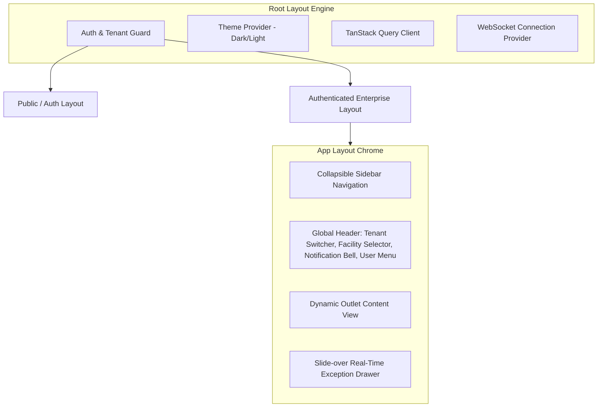

# 08. Frontend Screen Inventory & UX Flows

The CargoPulse frontend is architected as a modern, high-performance Single Page Application (SPA) utilizing:
- **Core Framework**: React 18+ with TypeScript
- **Bundler & Tooling**: Vite
- **Styling**: Tailwind CSS with custom design tokens
- **Component Primitives**: shadcn/ui (Radix UI accessible primitives)
- **Routing**: React Router v6+ with nested layouts and route guards
- **Server State & Caching**: TanStack Query (React Query v5)
- **Form Management**: React Hook Form with Zod schema validation
- **Icons**: Lucide React

---

## 1. Application Layout Architecture

---

## 2. Screen Inventory Catalog

### Category A: Authentication & Onboarding
| Screen ID | Route Path | Screen Name | Key Components & Capabilities |
|---|---|---|---|
| `AUTH-01` | `/login` | Secure Login | Email & password form, "Remember me", SSO button, MFA TOTP step modal. |
| `AUTH-02` | `/register` | Organization Registration | Company legal name, trade tax ID (GSTIN/EIN), admin user details, terms agreement. |
| `AUTH-03` | `/forgot-password` | Password Reset Request | Email input, anti-abuse rate limit timer, recovery link confirmation. |
| `AUTH-04` | `/reset-password` | Set New Password | Cryptographic token validation, password strength meter, confirmation. |

### Category B: Operations Cockpit & Monitoring
| Screen ID | Route Path | Screen Name | Key Components & Capabilities |
|---|---|---|---|
| `DASH-01` | `/dashboard` | Operations Overview | Metric KPI tiles (Active, Pickup Failed, In-Transit, Unreconciled), Kanban stage summary, interactive fleet map snippet. |
| `DASH-02` | `/dashboard/live-map` | Fleet Live Map View | Fullscreen Mapbox/Leaflet view, color-coded truck markers, live route polylines, cluster view, filter by lane and status. |
| `DASH-03` | `/dashboard/alerts` | Active Exceptions & Alerts | High-priority exception feed, SLA countdown badges, direct "Initiate Recovery" action buttons. |

### Category C: Shipment Management
| Screen ID | Route Path | Screen Name | Key Components & Capabilities |
|---|---|---|---|
| `SHIP-01` | `/shipments` | Shipment List & Registry | Advanced data table (shadcn), faceted filters (Plant, Carrier, Status, Date), bulk actions, export to Excel/CSV. |
| `SHIP-02` | `/shipments/new` | Create Shipment (Wizard) | Multi-step form: Step 1 (Origin Plant & Target Pickup), Step 2 (Consignee & Destination), Step 3 (Cargo & Vehicles), Step 4 (Docs & Review). Form validated with Zod. |
| `SHIP-03` | `/shipments/:id` | Shipment Detail View | Tabbed cockpit: Tab 1 (Overview & Cargo), Tab 2 (Live Tracking Timeline), Tab 3 (Gate Logs & Weighments), Tab 4 (e-POD), Tab 5 (Audit Log). |
| `SHIP-04` | `/shipments/:id/edit` | Edit Shipment | Pre-populated form for modifying shipment parameters prior to carrier commitment. |

### Category D: Matching, Tendering & Dispatch
| Screen ID | Route Path | Screen Name | Key Components & Capabilities |
|---|---|---|---|
| `MATCH-01`| `/matching` | Matching & Tenders Console | Real-time board of shipments awaiting tender; active waterfall timers, spot bidding status. |
| `MATCH-02`| `/matching/shipments/:id`| Tendering Workbench | Ranked carrier recommendations, manual vs. auto tender toggle, contract rate preview. |
| `BOOK-01` | `/bookings` | Booking Orders Registry | List of confirmed bookings, nomination SLA countdowns, vehicle assignment status. |
| `BOOK-02` | `/bookings/:id/nominate` | Vehicle & Driver Nomination | Carrier-facing screen: Select vehicle from fleet dropdown, assign licensed driver, submit nomination. |

### Category E: Pickup Accountability & Dock Operations
| Screen ID | Route Path | Screen Name | Key Components & Capabilities |
|---|---|---|---|
| `PICK-01` | `/pickup/dock-monitor` | Plant Dock Live Monitor | Plant-specific view: Berthing status of loading bays, truck queue, dwell time counters (highlighting billable detention risk). |
| `PICK-02` | `/pickup/gate-entry` | Security Gate Check-in | Fast-action mobile-optimized screen for Gate Officers: Enter shipment # / scan QR, send driver OTP, verify OTP, record physical checklist. |
| `PICK-03` | `/pickup/weighment` | Weighbridge Console | Record Tare Weight (empty) and Gross Weight (loaded), camera snap upload of weight ticket. |
| `PICK-04` | `/pickup/recovery` | Failed Pickup Recovery Hub | Urgent triage view: List of shipments with breached pickup SLAs; 1-click fallback tender cascade, spot auction initiator. |

### Category F: Tracking & Exception Management
| Screen ID | Route Path | Screen Name | Key Components & Capabilities |
|---|---|---|---|
| `TRACK-01`| `/tracking/:id` | Dedicated Tracking View | High-resolution route map, historical milestone breadcrumbs, current speed, telematics source health badge. |
| `EXCP-01` | `/exceptions` | Exception Incident Center | Centralized triage table of breakdowns, route diversions, accidents, and dock delays with escalation timer badges. |
| `EXCP-02` | `/exceptions/:id` | Exception Detail & Resolution | Incident timeline, driver chat log, transshipment authorization modal, dispute settlement notes. |

### Category G: Proof of Delivery & Freight Reconciliation
| Screen ID | Route Path | Screen Name | Key Components & Capabilities |
|---|---|---|---|
| `POD-01`  | `/pod/registry` | Proof of Delivery Inbox | Review queue for incoming delivery receipts, filterable by clean vs. damaged deliveries. |
| `POD-02`  | `/pod/verify/:id` | POD Verification Studio | Split-screen document viewer: Signed Challan photo on left, consignee digital signature and damage checklist on right. SHA-256 verification badge. |
| `RECON-01`| `/reconciliation` | Freight Audit & Invoicing | 3-way match dashboard: Original rate vs. gate-verified detention vs. carrier claimed invoice. |
| `RECON-02`| `/reconciliation/:id` | Invoice Discrepancy Workbench | Granular line-item reconciliation (Freight, Fuel Surcharge, Detention Hours, Penalties). 1-click "Approve Voucher" or "Issue Dispute". |

### Category H: Master Data & Admin
| Screen ID | Route Path | Screen Name | Key Components & Capabilities |
|---|---|---|---|
| `FLEET-01`| `/fleet/vehicles` | Vehicle Fleet Registry | Vehicle list, compliance document health indicators (Red/Yellow/Green for expiring RC/Insurance). |
| `FLEET-02`| `/fleet/drivers` | Driver Master Directory | Driver roster, KYC verification status, safety scorecards. |
| `RATE-01` | `/rate-cards` | Lane Rate Card Manager | Matrix of contracted lanes, base rates, detention slab rules. |
| `ORG-01`  | `/settings/organization`| Company Profile & Plants | Legal address, GSTIN, manufacturing facilities setup, dock configuration. |
| `ORG-02`  | `/settings/users` | User & Role Management | User table, invite user modal, role assignment, facility restriction dropdown. |
| `INTEG-01`| `/settings/integrations`| Integrations & Webhooks | ERP connector status cards (SAP/Oracle), outbound webhook endpoint manager, DLQ viewer. |
| `AUDIT-01`| `/audit-trail` | Compliance Audit Ledger | Chronological immutable event stream, actor filter, JSON state diff inspector. |

---

## 3. UI Component System Standards (shadcn/ui + Tailwind)

1. **Design Tokens**: Standardized palette with clear operational semantic tokens:
   - Primary: Deep Slate (`slate-900` / `slate-100`)
   - Brand Accent: Electric Indigo / Cyan (`indigo-600` / `cyan-500`)
   - Status Success: Emerald (`emerald-600`) - for `COMMITTED`, `GATE_IN`, `DELIVERED`
   - Status Warning: Amber (`amber-500`) - for `AT_RISK_PICKUP`, `TENDER_EXPIRING`
   - Status Destructive: Crimson (`rose-600`) - for `PICKUP_FAILED`, `BREACH`, `EXCEPTION`
2. **Form Validation Strategy**:
   - Every input managed via React Hook Form.
   - Validation schemas declared using Zod.
   - Immediate inline client validation combined with server-side validation error mapping.
3. **Optimistic Updates**:
   - TanStack Query configured for optimistic status updates on quick actions (e.g., Gate-In verification, tender acceptance) with automatic rollback on server error.
