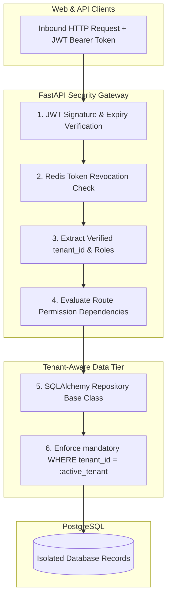

# 09. Security Architecture & Data Protection

CargoPulse handles sensitive supply chain, commercial contract, freight rate, and driver personal data. Security is engineered as a foundational, defense-in-depth architecture.

---

## 1. Multi-Tenant Isolation Architecture

### 1.1 Tenant Isolation Invariants
1. **Repository-Level Injection**: Every query passing through the application data tier inherits from a base repository that automatically attaches the current session's `tenant_id` filter.
2. **Zero Naked Queries**: Raw SQL queries are strictly prohibited; all access must use tenant-scoped SQLAlchemy ORM queries.
3. **Cross-Tenant Entity Access Rules**: Where cross-tenant collaboration is required (e.g., a Transporter inspecting an assigned Booking owned by a Shipper), access is permitted only through explicitly verified relationship tables (`bookings.transporter_tenant_id = :current_tenant`).

---

## 2. Authentication & Session Management

### 2.1 Cryptographic Token Strategy
- **Access Tokens**: Short-lived (15 minutes), signed with RS256 (RSA Signature with SHA-256). Payload includes `sub` (User ID), `tenant_id`, `org_type`, `role`, and `facility_scope_id`.
- **Refresh Tokens**: Cryptographically random 256-bit strings stored in Redis with a 7-day TTL. Rotation is strictly enforced: issuing a new access token invalidates the old refresh token and issues a new pair.
- **Token Revocation (Deny-list)**: Immediate revocation of user tokens upon logout, role alteration, or account suspension stored in Redis indexed by `user_id` and `token_jti`.

### 2.2 Password Security
- Passwords hashed using **Argon2id** (memory: 64MB, iterations: 3, parallelism: 4) or bcrypt (cost factor $\ge 12$).
- Mandatory complexity rules enforced via Zod on frontend and Pydantic on backend (minimum 12 characters, uppercase, lowercase, numeric, and symbol).

---

## 3. Data Protection & Cryptography

### 3.1 Encryption in Transit
- Strict Transport Security (HSTS) with a minimum duration of 1 year (`max-age=31536000; includeSubDomains; preload`).
- TLS 1.3 enforced across all public endpoints and microservices communication.

### 3.2 Encryption at Rest
- Database storage volumes encrypted using AES-256 at the block device level.
- Column-level encryption applied to highly sensitive Personally Identifiable Information (PII) including driver Aadhaar/National ID numbers, bank account details, and rate card monetary values using AES-256-GCM with keys managed via an external Key Management Service (KMS).

### 3.3 Proof of Delivery (POD) Cryptographic Verification
When an electronic Proof of Delivery (e-POD) is submitted:
1. The physical document photo, consignee signature, GPS coordinates, and timestamp are serialized.
2. A cryptographic SHA-256 checksum is computed.
3. The resulting hash is committed to the `pod_records` table and replicated to the `audit_ledger`.
4. Any subsequent attempt to alter the image or metadata invalidates the cryptographic hash check during freight audit.

---

## 4. API Security & Threat Mitigation

### 4.1 Rate Limiting & Abuse Prevention
- Implemented via Redis Token Bucket algorithm at the FastAPI middleware layer:
  - Public authentication endpoints (`/auth/login`, `/auth/register`): 10 requests per minute per IP.
  - Telemetry ingestion (`/tracking/telemetry`): 600 requests per minute per vehicle key.
  - Standard authenticated endpoints: 300 requests per minute per tenant user.
- Automatic temporary IP throttling upon 5 consecutive failed authentication attempts.

### 4.2 Webhook Security
1. **Outbound Signature Verification**:
   - Every outbound webhook sent to external ERPs or transporters includes the header `X-CargoPulse-Signature`.
   - The signature is calculated as:
     $$\text{Signature} = \text{HMAC-SHA256}(\text{TenantSecret}, \text{Timestamp} + "." + \text{PayloadBody})$$
   - Receiving systems verify integrity and prevent replay attacks using the timestamp tolerance window ($\le 5\text{ minutes}$).
2. **Inbound Webhook Verification**:
   - Inbound telematics and GPS vendor webhooks require static signature verification or shared secret authentication.

### 4.3 Input Validation & Content Security
- **Strict Input Sanitization**: All inbound JSON payloads strictly validated by Pydantic v2 schemas; extra fields rejected (`extra='forbid'`).
- **File Upload Protection**: Uploaded images (PODs, weight slips, KYC documents) validated for genuine MIME types, magic byte signatures, virus scanned, and stored in private S3-compatible object storage with presigned, time-bounded URLs.
- **CORS & Security Headers**: Explicit origin whitelisting, Content-Security-Policy (CSP), `X-Content-Type-Options: nosniff`, and `X-Frame-Options: DENY`.
