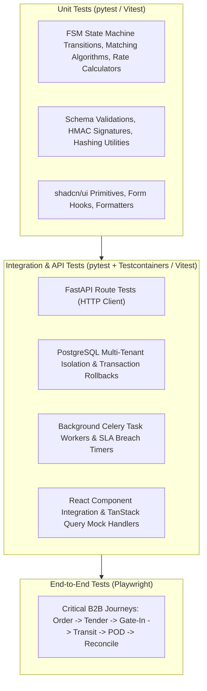

# 10. Comprehensive QA & Testing Strategy

Quality and operational reliability are existential for an accountable logistics platform. CargoPulse implements an exhaustive, multi-tier testing pyramid to guarantee deterministic execution, zero cross-tenant data leakage, and rigorous SLA compliance.

---

## 1. Testing Pyramid Architecture

---

## 2. Test Tooling & Frameworks

| Layer | Technology | Scope & Responsibility |
|---|---|---|
| **Backend Unit & Integration** | `pytest`, `pytest-asyncio`, `pytest-mock`, `httpx` | Fast test execution against async FastAPI endpoints, services, repositories, and state machines. |
| **Database Integration** | `PostgreSQL` (isolated test schema / Testcontainers) | Real SQL execution, foreign key constraints, JSONB queries, trigger testing, and transaction rollbacks per test. |
| **Worker & Task Queue Testing** | `pytest-celery`, `fakeredis` | Testing background task scheduling, timer cancellations, and retry mechanisms. |
| **Frontend Unit & Component** | `Vitest`, `@testing-library/react`, `jsdom` | React component rendering, user interactions, Zod form validation logic, custom hooks. |
| **End-to-End (E2E)** | `Playwright` (Chromium / Firefox / WebKit) | Browser-level simulation of full operational workflows across multiple role personas. |
| **Contract & Schema Validation** | `OpenAPI Generator`, `schemathesis` | Validating API request/response conformance against OpenAPI 3.1 specifications. |

---

## 3. Critical Test Scenarios & Invariant Testing

### 3.1 Multi-Tenant Isolation Verification
Every endpoint must have automated tests asserting that:
1. Tenant $A$ cannot view, query, or mutate Tenant $B$'s shipments, facilities, rate cards, or users.
2. Even if a user knows a valid UUID belonging to another tenant, the API strictly returns `404 Not Found` (never `403 Forbidden` which reveals entity existence).
3. SuperAdmin actions are logged to the audit ledger with cross-tenant context.

### 3.2 State Machine Transition Rules
Unit tests verifying strict finite state transitions for shipments:
- Cannot transition `DRAFT` $\rightarrow$ `IN_TRANSIT` (must fail with `InvalidStateTransitionException`).
- Cannot complete `GATE_IN` without valid OTP verification or authorized manager override.
- Cannot transition to `RECONCILED` without an approved e-POD document and hash verification.

### 3.3 SLA Breach & Failed Pickup Timers
Integration tests simulating time-travel (using `freezegun` or Celery task mock time):
- When a carrier fails to place a vehicle by the nomination cutoff, verify that Celery fires the timeout task, marks shipment as `PICKUP_FAILED_CRITICAL`, records an audit entry, and notifies the shipper dispatcher.
- Verify that if a carrier accepts and nominates before cutoff, the scheduled timeout task is cleanly revoked in Redis.

### 3.4 Financial 3-Way Match Calculation Tests
Deterministic unit tests covering rate computations:
- Exact detention fee calculations: $(\text{Total Dwell Time} - \text{Free Hours}) \times \text{Hourly Rate}$.
- Edge cases: Vehicle arrives early, vehicle arrives late, split detention slabs, weekend/holiday exclusions.

---

## 4. Test Data Management & Seed Hygiene

1. **Deterministic Test Factories**:
   - Built using `factory-boy` (Python) and mock fixtures (TypeScript).
   - Dynamic generation of valid UUIDv7 identifiers, valid GSTINs, and telephone numbers.
2. **Clear Demonstration vs. Production Separation**:
   - Seed data for demonstration purposes is strictly segregated in dedicated migration/seed scripts (`seeds/demo_seed.py`) with explicit prefixes (e.g., `DEMO-SHIP-001`, `demo.shipper@cargopulse.internal`).
   - Production environments strictly run schema migrations (`alembic upgrade head`) without demo seed data.

---

## 5. Continuous Integration (CI) Quality Gates

Every Pull Request must pass the following automated gates before merge:
1. **Linter & Type Checker**: `ruff check .`, `mypy --strict .` (backend); `eslint`, `tsc --noEmit` (frontend).
2. **Backend Test Suite**: $\ge 90\%$ code coverage on core domain services and state machines.
3. **Frontend Test Suite**: Component tests passing with zero console warnings.
4. **Security Audit**: Dependency vulnerability scan (`pip-audit`, `npm audit`), git secret scanning (trufflehog).
5. **E2E Smoke Tests**: Core shipment creation and gate-in flow verified in headless Playwright.
