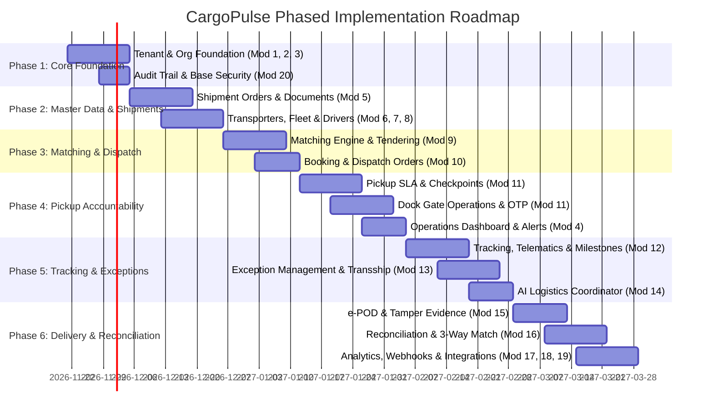

# 11. Phased Implementation Roadmap

CargoPulse is engineered as a modular monolith. To guarantee high quality, avoid fragile shortcuts, and ensure continuous testability, development is structured into **6 deliberate, sequential phases**.

---

## 1. Development Phases Overview

---

## 2. Milestone Deliverables Breakdown

### Phase 1: Multi-Tenant Core Foundation & Security
- **Target Modules**: Module 1 (Auth), Module 2 (Organizations), Module 3 (RBAC), Module 20 (Audit Trail).
- **Deliverables**:
  - PostgreSQL database initialization with Alembic migration baseline.
  - Multi-tenant tenant context middleware and base SQLAlchemy repository.
  - JWT authentication, refresh token rotation in Redis, and password hashing.
  - Role and permission evaluation engine.
  - Immutable audit logging interceptor capturing entity diffs.
- **Verification Gate**: 100% passing tests for tenant isolation, JWT authentication, and audit ledger immutability.

### Phase 2: Master Data & Shipment Management
- **Target Modules**: Module 5 (Shipment Management), Module 6 (Transporter Management), Module 7 (Vehicle Management), Module 8 (Driver Management).
- **Deliverables**:
  - Facilities and loading docks schema & APIs.
  - Carrier registry, vehicle compliance tracking (RC/Fitness/Insurance), and driver KYC directory.
  - Lane rate card management with detention terms.
  - Shipment order creation (wizard UI and REST endpoints) with Zod/Pydantic validation.
- **Verification Gate**: Full shipment creation and document attachment test coverage.

### Phase 3: Transporter Matching, Bidding & Dispatch
- **Target Modules**: Module 9 (Transporter Matching Engine), Module 10 (Booking & Dispatch).
- **Deliverables**:
  - Waterfall tendering engine with Celery countdown timers.
  - Spot bidding / broadcast auction logic.
  - Transporter portal: Tender acceptance, decline with reason codes.
  - Vehicle and driver nomination workflows with compliance verification.
  - Dispatch order (Lorry Receipt / Bilty) generation with scannable QR codes.
- **Verification Gate**: End-to-end simulation of multi-carrier waterfall cascades and nomination cutoffs.

### Phase 4: Ground Pickup Accountability & Operations Cockpit
- **Target Modules**: Module 11 (Pickup Accountability Engine), Module 4 (Operations Dashboard).
- **Deliverables**:
  - $T-4$h, $T-2$h, $T-1$h automated proactive confirmation triggers.
  - Plant security gate check-in console with 6-digit dynamic OTP verification.
  - Weighbridge tare and gross weighment recording with document capture.
  - Automated failed pickup detection triggering immediate critical status.
  - Real-time Operations Dashboard with WebSocket alerts and KPI counters.
- **Verification Gate**: E2E test of complete gate-in flow, OTP verification, and failed pickup timer firing.

### Phase 5: Tracking, Telematics & Exception Management
- **Target Modules**: Module 12 (Shipment Tracking), Module 13 (Exception Management), Module 14 (AI Logistics Coordinator).
- **Deliverables**:
  - GPS coordinate ingestion endpoint and Redis geo-indexing.
  - Geofence arrival and departure event triggers.
  - Exception reporting center (breakdown, delay, route deviation) with tiered escalation.
  - Cargo transshipment workflow for vehicle breakdowns.
  - AI risk scoring model predicting pickup failure probability.
- **Verification Gate**: Telematics load testing ($\ge 5,000\text{ pings/sec}$) and exception escalation tests.

### Phase 6: Proof of Delivery, Freight Reconciliation & Analytics
- **Target Modules**: Module 15 (e-POD), Module 16 (Reconciliation), Module 17 (Analytics), Module 18 (Integration Monitoring), Module 19 (Webhooks).
- **Deliverables**:
  - Mobile-responsive e-POD upload with consignee signature, cargo damage checklist, and SHA-256 hash.
  - 3-Way Match engine comparing rate cards, gate logs (detention), and carrier invoices.
  - Discrepancy approval workflow and payment voucher generation.
  - OTIF and transporter scorecard analytics dashboards.
  - HMAC-signed outbound webhooks and Dead-Letter Queue (DLQ) admin console.
- **Verification Gate**: Full end-to-end Playwright test from shipment creation to payment voucher export.
