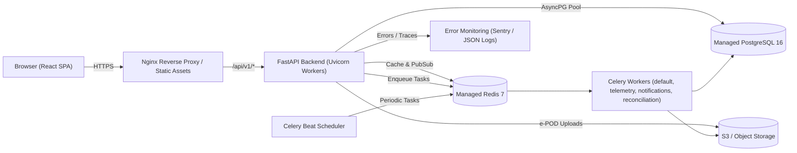

# System Architecture

## High-Level Topology

CargoPulse follows a multi-tier, multi-tenant architecture designed for strict organization isolation, resilient transporter integrations, and asynchronous event processing.

## Core Architectural Principles

1. **Multi-Tenant Isolation**: Every operational record (`shipments`, `transporter_bookings`, `pickup_commitments`, `exceptions`, `proof_of_deliveries`, `audit_logs`, `ai_sessions`) is scoped by `organization_id`. API dependencies enforce tenant boundaries on every query and mutation.
2. **State-Machine Driven Lifecycles**: Shipments, bookings, pickup commitments, exceptions, and AI action proposals follow explicit state transitions enforced in service layers.
3. **Resilient Integration Engine**: Outbound transporter webhooks, inbound telemetry ingestion, exponential-backoff retry queues, and dead-letter queues (DLQ) decouple external carrier systems from core dispatch APIs.
4. **Human-in-the-Loop AI Coordinator**: The AI Coordinator synthesizes grounded operational context and proposes structured actions that require explicit user confirmation before mutating database state.
5. **Immutable Auditability**: Security-sensitive actions, booking approvals, exception resolutions, and reconciliation decisions emit structured audit records and JSON application logs.

## Production Container Services

- **`frontend` (`nginx:1.27-alpine`)**: Serves the compiled Vite React bundle with cache headers, gzip compression, security headers, and `/api/` reverse proxying.
- **`backend` (`python:3.12-slim`)**: Runs `alembic upgrade head` on boot and serves FastAPI via multi-worker Uvicorn with `--proxy-headers`.
- **`celery_worker`**: Executes asynchronous tasks across dedicated queues (`default`, `telemetry`, `notifications`, `reconciliation`) with `dead_letter` routing on exhaustion.
- **`celery_beat`**: Dispatches scheduled periodic tasks (health heartbeat, SLA checks, reconciliation sweeps).
