# CargoPulse: PostgreSQL Database Architecture & Entity-Relationship Design

## 1. Architectural Overview

CargoPulse is an accountable multi-tenant B2B logistics coordination platform. The database architecture is built with **PostgreSQL 17+** as the **sole primary operational and analytical data store**, running on asynchronous **SQLAlchemy 2.x** and **Alembic**.

### Core Tenets

1. **PostgreSQL as the Exclusive Primary Database**:
   - No NoSQL or secondary document databases (no MongoDB).
   - Structured relational schemas enforce referential integrity across tenants, orders, carriers, tracking, and financial reconciliation.

2. **Tenant Isolation via `organization_id`**:
   - Every tenant-owned record carries an indexed `organization_id` referencing `organizations.id`.
   - Natural compound unique constraints (such as `(organization_id, email)` and `(organization_id, tracking_number)`) scope data cleanly within tenant boundaries.

3. **Standardized Identity & Temporal Guarantees**:
   - Primary keys use RFC 4122 **UUIDv4** across all 28 domain tables.
   - All timestamps are timezone-aware UTC (`TIMESTAMP WITH TIME ZONE`), captured with PostgreSQL `func.now()`.
   - Consistent audit columns (`created_at`, `updated_at`) via `TimestampMixin`.

4. **Soft Delete vs. Append-Only Immutability**:
   - Operational entities (shipments, transporters, users, bookings, recovery cases) implement `SoftDeleteMixin` (`is_deleted = false`, `deleted_at = NULL`).
   - Historical records, telemetry, and compliance trails (`shipment_events`, `audit_logs`, `outbox_events`, `webhook_events`) are strictly **append-only** and **immutable**. Hard deletion and soft-deletion are prohibited on these tables.

5. **Disciplined JSONB Utilization**:
   - Relational fields are used for all queryable, filterable, and constrained attributes (status, timestamps, postal codes, vehicle capacities, contact details).
   - PostgreSQL `JSONB` is reserved exclusively for genuinely dynamic, unstructured metadata:
     - `shipments.items_manifest` (line-item SKU descriptions, custom packaging dimensions)
     - `shipments.custom_metadata` (ERP-specific pass-through flags)
     - `audit_logs.changes` (diff snapshots before/after mutations)
     - `outbox_events.payload` (self-contained event payloads for async consumers)
     - `delivery_discrepancies.evidence_image_urls` (photo attachments)

6. **Transactional Outbox Pattern**:
   - Business mutations write domain records and corresponding `outbox_events` atomically within the same database transaction, eliminating dual-write inconsistency and ensuring at-least-once message delivery to Redis/Celery workers.

---

## 2. Entity-Relationship Diagram (ERD)

```mermaid
erDiagram
    ORGANIZATION ||--o{ USER : "has"
    ORGANIZATION ||--o{ ROLE : "defines"
    ORGANIZATION ||--o{ TRANSPORTER : "manages"
    ORGANIZATION ||--o{ SHIPMENT : "creates"
    ORGANIZATION ||--o{ EXCEPTION_RECORD : "records"
    ORGANIZATION ||--o{ AUDIT_LOG : "audits"
    ORGANIZATION ||--o{ INTEGRATION_CONNECTION : "connects"

    USER ||--o{ USER_ROLE : "assigned"
    ROLE ||--o{ USER_ROLE : "grants"
    ROLE ||--o{ ROLE_PERMISSION : "contains"
    PERMISSION ||--o{ ROLE_PERMISSION : "maps"
    USER ||--o{ REFRESH_SESSION : "maintains"
    USER ||--o{ PASSWORD_RESET_TOKEN : "requests"

    TRANSPORTER ||--o{ VEHICLE : "owns"
    TRANSPORTER ||--o{ DRIVER : "employs"
    TRANSPORTER ||--o{ TRANSPORTER_SERVICE_AREA : "services"
    TRANSPORTER ||--o{ TRANSPORTER_BOOKING : "receives"

    SHIPMENT ||--o{ TRANSPORTER_BOOKING : "dispatched_via"
    SHIPMENT ||--o{ SHIPMENT_ASSIGNMENT : "assigned_to"
    SHIPMENT ||--o{ SHIPMENT_EVENT : "logs_history"
    SHIPMENT ||--o{ PICKUP_COMMITMENT : "requires"
    SHIPMENT ||--o{ EXCEPTION_RECORD : "incurs"
    SHIPMENT ||--o| PROOF_OF_DELIVERY : "verified_by"
    SHIPMENT ||--o| RECONCILIATION_RECORD : "settles"

    EXCEPTION_RECORD ||--o{ RECOVERY_CASE : "triggers"
    PROOF_OF_DELIVERY ||--o{ DELIVERY_DISCREPANCY : "flags"

    VEHICLE ||--o{ SHIPMENT_ASSIGNMENT : "allocated"
    DRIVER ||--o{ SHIPMENT_ASSIGNMENT : "operates"

    ORGANIZATION {
        uuid id PK
        string name
        string slug UK
        string org_type
        boolean is_active
        jsonb settings
        timestamp created_at
        timestamp updated_at
    }

    USER {
        uuid id PK
        uuid organization_id FK
        string email
        string hashed_password
        string first_name
        string last_name
        boolean is_active
        timestamp last_login_at
    }

    ROLE {
        uuid id PK
        uuid organization_id FK
        string name
        string role_type
        boolean is_system_role
    }

    PERMISSION {
        uuid id PK
        string code UK
        string name
        string module
    }

    TRANSPORTER {
        uuid id PK
        uuid organization_id FK
        string name
        string code
        string phone
        float reliability_score
        boolean is_active
    }

    VEHICLE {
        uuid id PK
        uuid organization_id FK
        uuid transporter_id FK
        string license_plate
        string vehicle_type
        numeric capacity_kg
        boolean is_available
    }

    DRIVER {
        uuid id PK
        uuid organization_id FK
        uuid transporter_id FK
        string first_name
        string last_name
        string phone
        string license_number
        boolean is_available
    }

    SHIPMENT {
        uuid id PK
        uuid organization_id FK
        string tracking_number
        string status
        string origin_city
        string origin_postal_code
        string destination_city
        string destination_postal_code
        timestamp scheduled_pickup_time
        timestamp expected_delivery_time
        numeric total_weight_kg
        int package_count
        jsonb items_manifest
    }

    SHIPMENT_ASSIGNMENT {
        uuid id PK
        uuid organization_id FK
        uuid shipment_id FK
        uuid vehicle_id FK
        uuid driver_id FK
        string status
        timestamp assigned_at
    }

    SHIPMENT_EVENT {
        uuid id PK
        uuid organization_id FK
        uuid shipment_id FK
        string event_type
        string description
        timestamp occurred_at
        float latitude
        float longitude
        string source
        jsonb payload
    }

    PICKUP_COMMITMENT {
        uuid id PK
        uuid organization_id FK
        uuid shipment_id FK
        uuid transporter_id FK
        timestamp committed_pickup_slot_start
        timestamp committed_pickup_slot_end
        string status
        boolean is_breached
        numeric penalties_incurred
    }

    EXCEPTION_RECORD {
        uuid id PK
        uuid organization_id FK
        uuid shipment_id FK
        string exception_type
        string severity
        string status
        string title
        timestamp reported_at
    }

    RECOVERY_CASE {
        uuid id PK
        uuid organization_id FK
        uuid exception_id FK
        string case_number UK
        string strategy
        string status
        numeric estimated_cost_impact
    }

    PROOF_OF_DELIVERY {
        uuid id PK
        uuid organization_id FK
        uuid shipment_id FK,UK
        string signed_by_name
        timestamp signed_at
        string verification_status
        string signature_image_url
    }

    DELIVERY_DISCREPANCY {
        uuid id PK
        uuid organization_id FK
        uuid pod_id FK
        string discrepancy_type
        string item_name
        int expected_quantity
        int received_quantity
        numeric claimed_loss_amount
    }

    RECONCILIATION_RECORD {
        uuid id PK
        uuid organization_id FK
        uuid shipment_id FK,UK
        uuid transporter_id FK
        numeric base_freight_charge
        numeric penalties_deducted
        numeric final_payable_amount
        string status
    }

    OUTBOX_EVENT {
        uuid id PK
        uuid organization_id FK
        string aggregate_type
        uuid aggregate_id
        string event_type
        string status
        jsonb payload
        timestamp created_at
    }

    AUDIT_LOG {
        uuid id PK
        uuid organization_id FK
        uuid user_id FK
        string action
        string entity_name
        uuid entity_id
        jsonb changes
        timestamp created_at
    }
```

---

## 3. Entity Catalog (28 Domain Models)

### Group 1: Identity, Organization & Access Control
1. **`organizations`**: Multi-tenant boundary records with plan type, business tax identifier, slug, and settings.
2. **`users`**: Tenant-scoped accounts with Bcrypt hashed passwords and login tracking. `UniqueConstraint("organization_id", "email")`.
3. **`roles`**: Standard role definitions (Admin, Dispatcher, Coordinator, Driver, Auditor, Viewer) or custom tenant roles.
4. **`permissions`**: Granular capability permissions (e.g., `shipments:create`, `pod:verify`).
5. **`user_roles`**: User-to-Role assignments.
6. **`role_permissions`**: Role-to-Permission mappings.
7. **`refresh_sessions`**: Active JWT refresh token sessions with device telemetry, rotation, and revocation timestamps.
8. **`password_reset_tokens`**: Single-use cryptographic reset tokens with explicit expiration.

### Group 2: Transporters, Fleet & Capacity
9. **`transporters`**: Carrier / logistics partner profiles with reliability scores, on-time metrics, and compliance documents.
10. **`vehicles`**: Physical trucks and trailers with license plates, tonnage capacities, RC/insurance expiry, and telematics identifiers.
11. **`drivers`**: Commercial drivers with verified phone numbers, commercial license details, and status.
12. **`transporter_service_areas`**: Geographic origin-destination service lanes and postal code prefixes with estimated transit hours.

### Group 3: Shipments, Dispatch & Dock Accountability
13. **`shipments`**: Primary consignments with origin/destination addresses, contact coordinates, dock assignments, scheduled pickup/delivery windows, and weight/item specs.
14. **`transporter_bookings`**: Tenders sent to transporters with offered rates, expiry deadlines, and accept/reject statuses.
15. **`shipment_assignments`**: Vehicle and driver allocation to a shipment. Enforces a **partial unique index** (`uq_active_assignment_per_shipment`) ensuring only one active assignment (`ASSIGNED` or `ACCEPTED`) exists at any moment per shipment.
16. **`shipment_events`**: Append-only audit and tracking event log (telematics pings, status transitions, geofence entries).
17. **`pickup_commitments`**: Punctuality SLA contracts specifying scheduled dock time slots, actual arrival, breach flags, and contractual demurrage/penalties.

### Group 4: Operational Exceptions, Resolution & Financials
18. **`exceptions`**: Incidents logged during transit or dock loading (breakdown, delay, accident, route deviation).
19. **`recovery_cases`**: Workflow coordination cases for resolving exceptions (carrier rebooking, slot rescheduling, expedited relay).
20. **`proof_of_delivery`**: Digital e-POD documentation with consignee signature, GPS timestamp, and verification flags.
21. **`delivery_discrepancies`**: Line-item variance tracking (shortage, damage, overage, consignee rejection) with photographic evidence.
22. **`reconciliation_records`**: Financial clearing reconciling base freight, toll charges, detention fees, penalties, and POD clearance for billing.

### Group 5: Messaging, Integrations, Audit & AI
23. **`notifications`**: Omnichannel dispatch logs (Email, SMS, WhatsApp, Webhooks, In-App).
24. **`integration_connections`**: Third-party enterprise connectors (SAP ERP, Oracle TMS, Samsara, Fastag APIs).
25. **`webhook_events`**: Inbound webhook processing pipeline with status, retry counts, and payload logs.
26. **`outbox_events`**: Transactional outbox table guaranteeing resilient publishing to Celery workers and message queues.
27. **`audit_logs`**: Immutable security audit log tracking tenant actions, user IDs, IP addresses, entity IDs, and before/after diffs.
28. **`ai_action_records`**: Auditability log for the AI Logistics Coordinator (carrier ranking explanations, breach predictions, confidence metrics, and dispatcher approvals).

---

## 4. Key Constraints & Performance Indexes

| Constraint / Index Name | Table | Columns | Type / Purpose |
| :--- | :--- | :--- | :--- |
| `uq_users_org_email` | `users` | `(organization_id, email)` | Enforces unique email per organization while allowing multi-org user emails |
| `uq_shipments_org_tracking` | `shipments` | `(organization_id, tracking_number)` | Prevents duplicate tracking codes within a tenant |
| `uq_active_assignment_per_shipment` | `shipment_assignments` | `(shipment_id)` | **Partial Unique Index** where `status IN ('ASSIGNED', 'ACCEPTED') AND is_deleted = false` |
| `uq_pod_shipment` | `proof_of_delivery` | `(shipment_id)` | Enforces strict 1-to-1 relationship between shipment and its e-POD |
| `uq_reconciliation_shipment` | `reconciliation_records` | `(shipment_id)` | Guarantees single billing settlement per shipment |
| `ix_shipments_org_status` | `shipments` | `(organization_id, status)` | Fast dashboard querying and operational filtering |
| `ix_shipments_pickup_window` | `shipments` | `(organization_id, scheduled_pickup_time)` | Timely breach detection and dock slot scheduling |
| `ix_shipment_events_shipment_time` | `shipment_events` | `(shipment_id, occurred_at)` | Chronological event replay and real-time timeline display |
| `ix_outbox_status_created` | `outbox_events` | `(status, created_at)` | High-throughput outbox publisher polling query |
| `ix_audit_org_time` | `audit_logs` | `(organization_id, created_at)` | Fast tenant-scoped security audits and compliance reviews |
